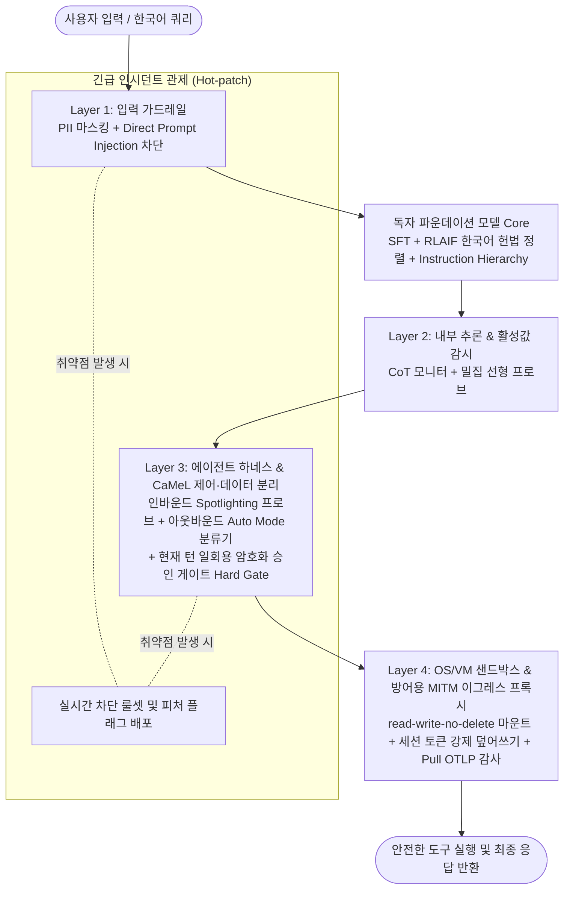

# Track 4: Sovereign AI & Practical Application for Independent Foundation Models

> **자체 파운데이션 모델을 구축·운영하는 기업 및 연구소를 위한 실전 안전 파이프라인 및 거버넌스 프레임워크**

---

## 📌 트랙 개요
Track 4에서는 한국을 비롯한 **소버린 AI(Sovereign AI)** 및 독자 파운데이션 모델 구축 팀이 직면하는 현실적인 제약(제한된 컴퓨팅/인력, 언어적·문화적 특수성, 국내 법제도) 속에서 최적의 안전 및 거버넌스 체계를 구축하는 실전 방법론을 다룹니다.

---

## 🎯 핵심 학습 목표
1. **도구 사용(Tool-Use) 및 자율 에이전트 4계층 격리·가드레일 (Week 13)**:
   - OS 샌드박스(`Seatbelt`/`bubblewrap`)·컨테이너(`gVisor`)·하이퍼바이저 VM 기반 환경 격리, 방어용 MITM 세션 토큰 이그레스 프록시, 인바운드 프로브 + 아웃바운드 `Auto Mode` 이중 분류기, 프롬프트 지시를 대체하는 하네스 수준 결정론적 승인 게이트(`Hard Execution Gate`) 및 `CaMeL` 제어·데이터 흐름 분리 구축.
   - 상세 실전 가이드: [`resources/agentic_tool_guardrails_guide.md`](../resources/agentic_tool_guardrails_guide.md) 및 [Week 13 리뷰](../reviews/week-13/review_week13.md)
2. **비용 효율적인 경량 안전 파이프라인 (Cost-efficient Safety Pipeline)**:
   - 오픈소스 안전 모델(Llama Guard, NeMo Guardrails, ShieldGemma 등)과 중간 레이어 선형 프로브를 조합한 다중 인퍼런스 방어벽 구축.
3. **한국어 및 국내 규제 특화 안전성 (Korean Specifics & Compliance — Week 14)**:
   - **한국형 안전·편향·가치 정렬 벤치마크 결합**: 단순 기계번역 셋을 배제하고 `KoBBQ`(`76,048` 샘플)·`SQuARe`(`49k` 민감 질의)·`KoSBi`(`34k` 쌍)·`KorNAT`(`10K` 국가 가치·지식)·`KSAFE-MM`(한국 문화 멀티모달 안전)을 통합 회귀 스위트로 운용하며 차단율과 과차단율을 쌍(pair)으로 계측.
   - **교차언어·한글 자모(Jamo) 우회 방어**: 다국어 안전 분류기(`PolyGuard`, 17개 언어)와 유니코드 자모 정규화 + 중간 레이어 선형 프로브(`TACoT` 라우팅)를 결합해 초성체·자모 분리·다국어 혼합 탈옥 차단.
   - **국내 법제 엔지니어링 내재화**: 「인공지능기본법」 제31조(생성물·딥페이크 표시), 제32조($10^{26}$ FLOPs 고성능 AI 안전성), 제33조·제34조(고영향 AI 위험관리·설명·인간 감독·문서 보관 5대 책무), 개인정보보호위원회 생애주기 4단계 안내서(2025. 8), TTA `CAT 2.0` 및 금융보안원 평가 프레임워크 대응.
   - 상세 실전 가이드: [`resources/korean_ai_constitution_guide.md`](../resources/korean_ai_constitution_guide.md) 및 [Week 14 리뷰](../reviews/week-14/review_week14.md)
4. **인시던트 대응 및 모델 재조정 런북 (Incident Response & Patching Runbook)**:
   - Claude Fable 5, GPT-5.6 등의 선례와 같이, 배포 후 보안 취약점이 발견되었을 때 서비스 중단 최소화 및 긴급 회수/가드레일 재조정(Post-hoc Patching) 프로세스 구축.
   - 상세 실전 가이드: [`resources/lightweight_rsp_blueprint.md`](../resources/lightweight_rsp_blueprint.md) 및 [`resources/incident_runbook.md`](../resources/incident_runbook.md)

---

## 📖 소버린 AI 4계층 심층 방어 & 에이전트 격리 아키텍처

---

## 🇰🇷 실전 배포 체크리스트 (Sovereign AI Blueprint)

- [ ] **데이터셋 전처리**: 개인정보(주민번호, 전화번호, 계좌 등) 정규식 및 NER 기반 사전 비식별화 완료.
- [ ] **헌법적 정렬**: 한국 사회 가치관 및 현행법을 반영한 Harmlessness Constitution 작성 및 RLAIF 반영 ([`korean_ai_constitution_guide.md`](../resources/korean_ai_constitution_guide.md)).
- [ ] **입/출력 가드레일 & 선형 프로브**: 경량 분류기(Inference Classifier) 및 중간 레이어 선형 프로브 레이턴시 < 20ms 유지 ([`reasoning_cot_safety_guide.md`](../resources/reasoning_cot_safety_guide.md)).
- [ ] **에이전트 환경 격리 & 결정론적 하드 게이트**: 심볼릭 링크 사전 해석(`realpath`), `read-write-no-delete` 마운트, 방어용 MITM 프록시, `Tier 2` 고위험 도구 현재 턴 일회용 암호화 승인 토큰 및 `CaMeL` 데이터 흐름 정책 적용 ([`agentic_tool_guardrails_guide.md`](../resources/agentic_tool_guardrails_guide.md)).
- [ ] **시스템 카드 발행**: 모델 스펙, 잔여 한계점, 안전성 평가 수치를 담은 투명성 문서 공개 ([`frontier_eval_playbook.md`](../resources/frontier_eval_playbook.md)).
- [ ] **인시던트 런북**: 이상 징후 감지 시 10분 내 특정 기능/도메인 차단 가능한 피처 플래그 운영 ([`incident_runbook.md`](../resources/incident_runbook.md)).
