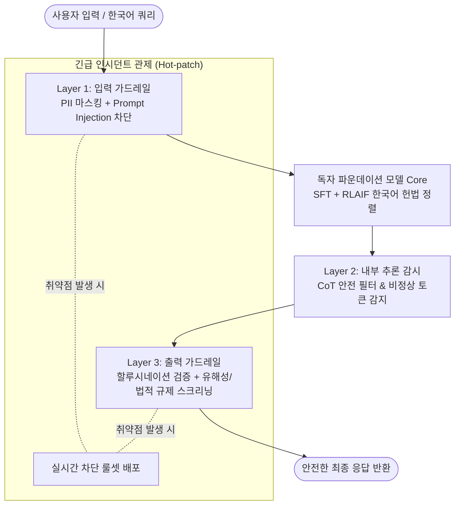

# Track 4: Sovereign AI & Practical Application for Independent Foundation Models

> **자체 파운데이션 모델을 구축·운영하는 기업 및 연구소를 위한 실전 안전 파이프라인 및 거버넌스 프레임워크**

---

## 📌 트랙 개요
Track 4에서는 한국을 비롯한 **소버린 AI(Sovereign AI)** 및 독자 파운데이션 모델 구축 팀이 직면하는 현실적인 제약(제한된 컴퓨팅/인력, 언어적·문화적 특수성, 국내 법제도) 속에서 최적의 안전 및 거버넌스 체계를 구축하는 실전 방법론을 다룹니다.

---

## 🎯 핵심 학습 목표
1. **비용 효율적인 경량 안전 파이프라인 (Cost-efficient Safety Pipeline)**:
   - 오픈소스 안전 모델(Llama Guard, NeMo Guardrails, ShieldGemma 등)을 조합한 3중 인퍼런스 방어벽 구축.
2. **한국어 및 국내 규제 특화 안전성 (Korean Specifics & Compliance)**:
   - 개인정보보호법, 공공기관 보안성 가이드라인, 인공지능기본법에 맞춘 프롬프트 필터링 및 비식별화 체계.
   - 다국어 번역 기반 탈옥(Cross-lingual Jailbreak) 및 한국 역사/정치적 논쟁 이슈에 대한 중립성 보장.
3. **인시던트 대응 및 모델 재조정 런북 (Incident Response & Patching Runbook)**:
   - Claude Fable, GPT-5.6 등의 선례와 같이, 배포 후 보안 취약점이 발견되었을 때 서비스 중단 최소화 및 긴급 회수/가드레일 재조정(Post-hoc Patching) 프로세스 구축.

---

## 📖 소버린 AI 3계층 방어 아키텍처

> ✅ **보완 (2026-11-10, Week 13 리뷰 결과)**: 위 3계층 도식은 **입력·추론·출력**, 즉 모델이 *말하는 것*만 지킵니다. 모델이 도구·셸·브라우저·네트워크로 *행동*하는 에이전트에서는 2026년 실제 사고 대부분이 이 세 층 밖, **실행 환경**에서 터졌습니다(평가 환경의 열린 인터넷, 제로데이 샌드박스 탈출, 사용자 경유 자격증명 유출 25회 중 24회, 허용 도메인을 통한 파일 유출). 따라서 에이전트 배포에는 두 층을 더해 읽습니다.
> - **Layer 0 — 실행 환경 봉쇄 (결정론적)**: 자격증명은 샌드박스 밖 볼트·프록시, egress 기본 차단 + **허용목록을 권한 부여로 심사**, 마운트 모드, 신뢰 승인 전 설정 파싱 금지. *모든 확률적 방어가 놓쳤을 때 마지막으로 맞는 층.*
> - **Layer 2.5 — 행동 게이트 (확률적)**: 도구 결과에 대한 인젝션 프로브 + **사용자 메시지와 도구 호출만 보는 추론 맹목 행동 분류기**(Layer 2의 CoT 감시와 직교), 거부 후 계속, 하위 에이전트 위임·반환 검사.
>
> 상세는 [Week 13 리뷰](../reviews/week-13/review_week13.md) 및 [에이전트 봉쇄 & 도구 사용 가드레일 실전 가이드](../resources/agent_containment_guide.md) 참조. 국내 지침(과기정통부·KISA 「에이전틱 AI 제로트러스트 안내서」, 2026-11-06)의 4개 검증 지점(입력 처리 · 도구 호출 · 작업 위임 · 외부 통신) 대응표는 가이드 §7.4에 있습니다.

---

## 🇰🇷 실전 배포 체크리스트 (Sovereign AI Blueprint)

- [ ] **데이터셋 전처리**: 개인정보(주민번호, 전화번호, 계좌 등) 정규식 및 NER 기반 사전 비식별화 완료.
- [ ] **헌법적 정렬**: 한국 사회 가치관 및 현행법을 반영한 Harmlessness Constitution 작성 및 RLAIF 반영.
- [ ] **입/출력 가드레일**: 경량 분류기(Inference Classifier) 레이턴시 < 20ms 유지.
- [ ] **시스템 카드 발행**: 모델 스펙, 잔여 한계점, 안전성 평가 수치를 담은 투명성 문서 공개.
- [ ] **인시던트 런북**: 이상 징후 감지 시 10분 내 특정 기능/도메인 차단 가능한 피처 플래그 운영.
- [ ] **에이전트 실행 환경 봉쇄** *(Week 13 추가)*: 자격증명 샌드박스 비노출, egress 기본 차단 및 허용 도메인별 도달 가능 기능 심사, 승인율·개입률 측정 ([가이드 §2·§7.1](../resources/agent_containment_guide.md)).
- [ ] **평가 환경 위생** *(Week 13 추가)*: 안전장치를 끈 평가·RL 환경의 매 실행 전 봉인 검증, 대상 모델의 사전 탈출 시험, 범위는 환경 서술이 아닌 행동 지시문으로 ([가이드 §6](../resources/agent_containment_guide.md)).
