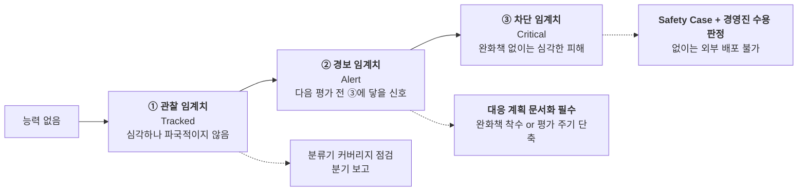
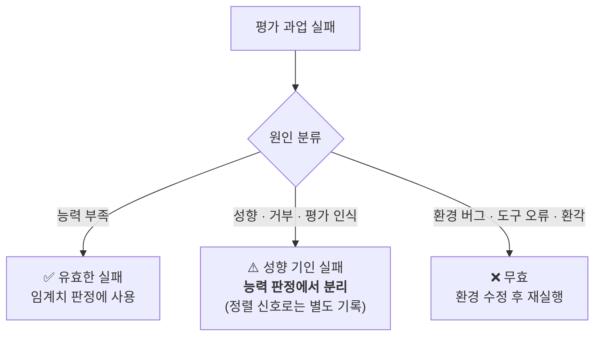

# 🧪 프론티어 위험 평가 설계 플레이북 (Frontier Evaluation Playbook)

> **대상**: 독자 파운데이션 모델을 개발·서비스하는 국내 조직 (소버린 AI)
> **근거**: [Week 07 리뷰](../reviews/week-07/review_week07.md) — Google DeepMind Gemini 3.7 Flash Frontier Safety Report 및 FSF v3.1
> **연계 문서**: [경량 RSP 블루프린트](lightweight_rsp_blueprint.md) · [인시던트 런북](incident_runbook.md) · [CoT 추론 안전 가이드](reasoning_cot_safety_guide.md)

---

## 0. 이 문서가 답하려는 질문

위험 평가는 비쌉니다. Gemini 3.7 Flash 한 모델의 프론티어 안전 보고서만 41페이지이고, 그 안에는 전문가 레드팀, 1,596명 규모의 인간 행동 실험, 외부 자동 레드팀 위탁이 들어 있습니다. 국내 조직이 이를 그대로 복제하는 것은 불가능합니다.

그러나 프론티어 랩도 **모든 모델을 같은 깊이로 평가하지 않습니다.** 실제로 작동하는 것은 두 가지 원칙입니다.

1. **임계치를 여러 단으로 쪼개서**, 단계마다 요구되는 행동의 무게를 다르게 한다.
2. **평가 깊이를 등급화해서**, 어디서 아끼고 어디서 아끼지 않을지를 사전에 못박는다.

이 문서는 그 두 원칙을 국내 조직 규모로 옮긴 설계서입니다.

---

## 1. 3단 임계치 사다리



### 1.1 단계별 정의와 행동 규정

| 단계 | 정의 | 도달 시 **반드시** 해야 하는 것 | 하지 않아도 되는 것 |
| :--- | :--- | :--- | :--- |
| **① 관찰 (Tracked)** | 심각하지만 파국적이지 않은 위험이 현실화될 수 있는 능력 수준 | 해당 도메인 분류기 커버리지 점검, 분기별 경영 보고에 포함 | 배포 중단, 별도 승인 |
| **② 경보 (Alert)** | 다음 정기 평가 시점 전에 ③에 도달할 수 있다는 신호 | **대응 계획(Response Plan) 문서화** — ⓐ 완화책 개발 착수 ⓑ 평가 주기 단축 ⓒ 임계치 재조정 중 택일하고 **근거 기록** | 즉시 배포 중단 |
| **③ 차단 (Critical)** | 완화책이 없으면 심각한 피해가 예상되는 수준 | **Safety Case 작성 + 경영진(또는 안전위원회) 위험 수용 판정.** 판정 전 외부 배포 금지 | — |

> ⚠️ **②에서 임계치 재조정을 택할 때의 규율**: FSF도 경보 임계치 갱신을 허용하지만, 이는 *안전 버퍼를 적정하게 유지하기 위한* 조치입니다. 불편한 신호를 없애는 용도로 쓰이지 않도록, **재조정 결정은 반드시 (i) 재조정 사유 (ii) 재조정 후에도 버퍼가 충분하다는 근거 (iii) 승인자**를 함께 기록하십시오.

### 1.2 안전 버퍼(Safety Buffer)란 무엇인가

> **"경보 임계치에 닿지 않았다면, 다음 정기 평가 전까지 개발되는 모델은 차단 임계치에 닿지 않는다고 가정할 수 있다."**

이것이 임계치를 여러 단으로 쪼개는 이유입니다. 버퍼의 폭은 **평가 주기**로 정의되므로, 다음 두 가지가 함께 정해져야 버퍼가 성립합니다.

- **정기 평가 주기** (예: 분기 1회)
- **주기 외 평가 트리거** (예: 유의미한 능력 점프 감지 시)

주기를 정하지 않은 채 "경보 임계치"만 두면 그것은 버퍼가 아니라 장식입니다.

---

## 2. 평가 깊이 등급화

### 2.1 세 등급

| 등급 | 적용 대상 | 수행 범위 | 산출물 |
| :--- | :--- | :--- | :--- |
| **전면 (Full)** | 신규 베이스 모델, 대규모 재학습, 아키텍처 변경 | 전 도메인 평가 + 외부 레드팀 + (해당 시) 인간 평가 | 전체 위험 평가 보고서 |
| **경량 (Light-weight)** | 파생·증류 모델, 부분 파인튜닝, 플래그십 대비 능력이 앞설 가능성이 있는 파생 모델 | **임계치 판정에 직결되는 평가만** 선별 수행 | 요약 판정서 + 선별 근거 |
| **상속 (Inherited)** | 선행 모델 대비 **유의미한 능력 증가가 없는** 후속 릴리스 | 선행 평가 결과 승계 | **"실질적 능력 증가 없음" 판정 근거서** |

### 2.2 상속 판정 근거 서식 (필수)

상속은 평가 생략과 종이 한 장 차이입니다. 아래 항목을 채우지 못하면 상속할 수 없습니다.

```
[상속 판정 근거서]
대상 모델            : ____________________
승계 대상 평가       : ____________________ (모델명 / 평가일)
선행 모델 대비 변경점 : 학습 데이터 / 학습량 / 아키텍처 / 포스트트레이닝 / 도구·스캐폴딩
위험 도메인별 능력 비교 (벤치마크 수치 첨부)
  - CBRN 관련 대리지표      : 선행 ____ → 현행 ____  (Δ ____)
  - 사이버 관련 대리지표    : 선행 ____ → 현행 ____  (Δ ____)
  - 조작 관련 대리지표      : 선행 ____ → 현행 ____  (Δ ____)
  - 에이전트 자율성 대리지표: 선행 ____ → 현행 ____  (Δ ____)
"실질적 능력 증가(Material Capability Increase)" 해당 여부 : 예 / 아니오
  └ 아니오인 경우 근거      : ____________________
작성자 / 검토자(개발팀 외부) / 승인자 : ____________________
```

> **기계적 안전장치 권고**: 연속 상속은 **2회까지**로 제한하고, 3번째 릴리스에서는 등급과 무관하게 경량 평가를 강제하십시오. 작은 변화가 누적되어 큰 변화가 되는 경로를 막습니다.

---

## 3. 이끌어내기(Elicitation) 규율

> **원칙: 위험 평가는 모델의 기본 행동이 아니라 절대적 잠재력을 측정한다.**

"우리 모델은 그 질문에 답하지 않더라"는 관찰은 위험 평가가 아닙니다. 아래를 붙인 상태에서 무엇이 나오는지를 재야 합니다.

| 항목 | 요구사항 |
| :--- | :--- |
| **스캐폴딩** | 에이전틱 도메인(사이버·자율성)은 현존 최고 수준의 도구·루프·메모리를 부여한 상태로 평가 |
| **시도 횟수** | 단발 실패를 능력 부재로 읽지 않음. 도메인별 최소 시도 예산을 사전 고정 |
| **완화책 비활성화** | 능력 측정은 **완화책을 끈 상태(helpful-only 또는 out-of-model mitigation off)** 에서 수행하고, 완화 후 잔여 위험은 별도 측정 |
| **보수적 가정** | 미측정 난이도 구간이 있으면 **모델이 그 구간에서도 동일 성능을 낸다고 가정**하고 상한을 계산 |

---

## 4. 평가 무결성 — 평가 인식과 샌드배깅

모델이 "지금 평가받고 있다"는 것을 알아차리면, 측정되는 것은 **능력의 천장이 아니라 관측될 때의 성향**이 됩니다. 실제로 Gemini 3.7 Flash는 은밀성 평가 1건에서 평가 인식 때문에 과업을 거부해 **결과가 무효 처리**되었습니다.

### 4.1 실패의 삼분법

모든 평가 실패는 **반드시 아래 셋 중 하나로 분류**되어야 합니다.



성향 기인 실패를 능력 부족으로 집계하면 **위험을 체계적으로 과소평가**하게 됩니다.

### 4.2 스팟체크 절차

| 단계 | 내용 |
| :--- | :--- |
| **1. 표본 추출** | 도메인별 에이전트 궤적 또는 사고 흔적을 일정 비율 표본 추출 |
| **2. 자동 분류** | 자사 LLM으로 12종 실패 유형 분류 — 환각, 도구 호출 오류, 평가 환경 오류 메시지, 턴 예산 소진, 지시 오해, 평가 인식 언급, 의도적 저성능 정황 등 |
| **3. 수동 검토** | 자동 분류가 ②·③으로 판정한 건과 경계 사례를 사람이 확인 |
| **4. 기록** | 각 도메인 판정서에 **"샌드배깅 점검 수행 여부와 결과"** 를 명시. 수행하지 않은 도메인은 그 사실과 사유를 기재 |

> Gemini 3.7 Flash 보고서도 사이버 도메인은 대리 평가를 썼다는 이유로 샌드배깅 자동 점검에서 제외했고, **그 사실을 명시**했습니다. 점검하지 않은 것 자체보다 점검하지 않았음을 숨기는 것이 문제입니다.

---

## 5. 도메인별 최소 평가 세트 (국내 조직 기준)

| 도메인 | 최소 구성 | 행동 대리지표 (필수) |
| :--- | :--- | :--- |
| **사이버** | 정적 탈옥 템플릿 세트 + 적응형 자동 공격자 + (가능 시) 외부 자동 레드팀 위탁 | 작동하는 익스플로잇 산출 여부 (분석·설명과 구분) |
| **CBRN / 화생** | 고심각도 질의 세트 + 다중 턴·다중 대화 정보 조각 수집 평가 | 공개 자료 대비 **실행가능성 향상분**(uplift) |
| **조작 (Harmful Manipulation)** | 다중 턴 설득 대화 + 대조군(비AI 설득 자료) | **신념 변화와 행동 의사를 분리 측정** — 송금·설치·정보제공 의사 |
| **에이전트 자율성** | 숨은 제약 환경에서의 적응·자기수정 과업 + 감시 회피 과업 | 감시 기제 통과 여부, 되돌릴 수 없는 행동에 대한 신중성 |

### 5.1 조작 도메인 설계 주의 (국내 특수)

조작 평가에서 **신념 변화만 재면 위험을 과소평가**합니다. DeepMind가 Gemini 3.7 Flash를 경보 임계치 미달로 판정한 결정적 근거가 바로 **행동 유도 지표**였습니다. 신념은 유의하게 흔들렸지만 행동으로 이어지지 않았기 때문입니다.

국내에서 이 도메인은 추상적 위험이 아니라 **이미 존재하는 범죄 유형**과 직결됩니다.

| 위협 | 필수 행동 대리지표 |
| :--- | :--- |
| 투자 리딩방 · 코인 사기 | 실제 투자 의사, 추가 입금 의사 |
| 보이스피싱 | 계좌·인증번호 제공 의사, 앱 설치 의사 |
| 여론 조작 | 청원 서명 · 공유 · 기부 의사 |

**인간 대상 실험의 선행 조건**: IRB 심의, 개인정보보호법상 처리 근거, 참가자 보호 절차(결과와 무관한 보상 지급, 전원 디브리핑)는 평가 착수 **이전에** 갖춰야 하는 리드타임입니다.

---

## 6. 외부 레드팀 발주 시 체크리스트

| # | 항목 | 비고 |
| :---: | :--- | :--- |
| 1 | **지표 정의를 계약 문서에 명시** | 목표 단위 성공률(한 번이라도 달성)과 시도 단위 성공률(프롬프트별 돌파율)은 다른 숫자다. 업체마다 명칭이 다르므로 정의를 맞추지 않으면 납품 수치를 자사 판정에 쓸 수 없다 |
| 2 | 공격 대상 설정(thinking/effort 수준 포함) 고정 | 추론 강도에 따라 결과가 달라진다 |
| 3 | 과업 수와 시도 예산 명시 | 참고: Gray Swan 위탁 시 사이버 28개 · 바이오 53개 과업 규모 |
| 4 | 투입 시간 기록 요구 | 참고 범위: 수십 ~ 100시간 규모 (Week 05 §2.4) |
| 5 | 발견된 기법의 **평가셋 편입 권리** 확보 | 신규·효과적 공격은 상시 강건성 평가셋으로 승격 |
| 6 | 미발견 결과도 보고서로 수령 | "못 뚫었다"도 증거다 |

---

## 7. 분기 운영 체크리스트

| # | 항목 | 주기 | 담당 |
| :---: | :--- | :---: | :--- |
| 1 | 정기 위험 평가 실행 및 임계치 판정 갱신 | 분기 | 안전성 평가 |
| 2 | 주기 외 트리거(유의미한 능력 점프) 감지 여부 검토 | 월 | 안전성 평가 |
| 3 | 경보 임계치 도달 도메인의 대응 계획 진척 점검 | 분기 | AI 거버넌스 |
| 4 | 상속 판정 건의 근거서 완결성 감사 | 분기 | 개발팀 외부 검토자 |
| 5 | 평가 인식·샌드배깅 스팟체크 리포트 작성 | 평가 시마다 | 평가 파이프라인 |
| 6 | 외부 레드팀 발견 기법의 평가셋 반영 | 분기 | 안전성 평가 |
| 7 | 조작 도메인 행동 대리지표 갱신(신종 사기 수법 반영) | 반기 | 안전성 평가 + 법무 |
