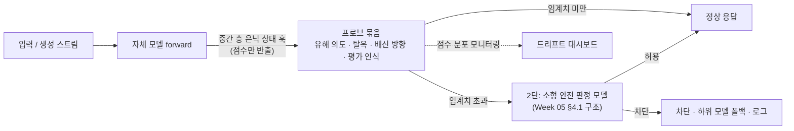

# 🔬 화이트박스 감사 & 활성값 모니터링 실전 가이드 (White-box Audit & Activation Monitoring)

> **대상**: 자체 가중치를 보유하고 독자 파운데이션 모델을 개발·서비스하는 국내 조직 (소버린 AI)
> **근거**: [Week 12 리뷰](../reviews/week-12/review_week12.md) — 기계론적 해석가능성 & SAE, 2026년 3사 실전 사용, Track 3 종합
> · [Week 05](../reviews/week-05/review_week05.md) · [Week 06](../reviews/week-06/review_week06.md) · [Week 07](../reviews/week-07/review_week07.md) — 3사 활성값 기반 배포 세이프가드
> · [Week 11](../reviews/week-11/review_week11.md) — `N=2` 배신 프로브, 비언어화 평가 인식
> **연계 문서**: [프론티어 평가 플레이북 §10](frontier_eval_playbook.md) · [CoT 추론 안전 가이드 §6](reasoning_cot_safety_guide.md) · [인시던트 런북](incident_runbook.md) · [경량 RSP 블루프린트](lightweight_rsp_blueprint.md)

---

## 0. 이 문서가 답하려는 질문

API로만 모델을 쓰는 조직은 출력·추론·행동만 볼 수 있습니다. **자체 가중치를 가진 조직은 활성값을 볼 수 있습니다.** Week 09~11에서 확인했듯 훈련·CoT·행동 감사에는 각각 2026년 실증으로 확인된 구멍이 있고, 활성값은 그 구멍을 보완하는 마지막 층입니다.

그러나 빅테크의 해석가능성 장비를 그대로 들여올 수는 없습니다. Gemma 2 전 층 SAE에는 GPT-3 학습 연산량의 20% 이상이 들었고(Gemma Scope), NLA는 모델 두 사본에 강화학습이 필요하며 Anthropic 스스로 대규모 감시에는 비실용적이라고 밝혔습니다.

이 문서는 **세 가지 원칙**을 국내 조직 규모로 옮긴 운영 표준입니다.

1. **탐지는 프로브, 발견은 SAE·언어화 도구** — 찾을 대상을 알면 지도 학습 프로브가 더 싸고 더 잘 작동한다(DeepMind 2025-03, Kantamneni 외, AxBench). 비지도 도구는 *모르는 것*을 찾을 때 쓴다.
2. **화이트박스는 판결이 아니라 정황 증거** — 서로 다른 도구 2종 또는 행동 재표본과 교차 확인되기 전에는 결론으로 쓰지 않는다(Anthropic 사이버 사고 평가 2026-09).
3. **감시 신호는 훈련 신호가 아니다** — 프로브 점수·특징 활성·감정/페르소나 표지를 보상이나 처벌에 쓰면 모델이 가리는 법을 배울 수 있다(감정 벡터 연구 2026-04, Week 10 감시가능성 세금).

---

## 1. 도구 선택 매트릭스

| 질문 | 도구 | 필요한 접근 | 비용 | 도입 Tier | 이 문서 |
| :--- | :--- | :--- | :---: | :---: | :---: |
| 이 입력·생성이 유해 의도/탈옥인가? (실시간) | 선형 프로브 · 경량 MLP 활성값 분류기 | 은닉 상태 + 라벨 데이터 | 💲 | 0 | §2 |
| 모델이 배신·기만 방향에 있는가? | 대조 쌍(`N=2`) 방향 프로브 | 은닉 상태 + 대조 문장 쌍 | 💲 | 0 | §2.5 |
| 모델이 평가받고 있다고 생각하는가? | 평가 인식 프로브 (3분할 측정) | 은닉 상태 + 평가/실사용 표본 | 💲 | 0 | §6.1 |
| 모델 안에 모르는 무엇이 있는가? | SAE 특징 탐색 | 오픈 SAE 또는 자체 1~2층 SAE | 💲💲 | 1~2 | §3 |
| 답이 어떤 경로로 나왔는가? | Attribution graph (`circuit-tracer`) | 트랜스코더 | 💲💲 + 사람 시간 | 1 | §3 |
| 기반 모델·직전 릴리스와 무엇이 다른가? | Crosscoder / DFC model diffing | 두 체크포인트 | 💲💲 | 2 | §5 |
| 모델이 말하지 않은 것은? | NLA · 단어 렌즈 | NLA 학습 또는 공개 NLA | 💲💲💲 | 3 (보류) | §6.3 |
| 행동을 바꾸고 싶다 | 프롬프트 → 미세조정 → 예방적 조향 순 | — | 💲~💲💲 | — | §4 |

---

## 2. Tier 0 — 활성값 프로브 운영 표준

### 2.1 아키텍처



- **위치**: 프롬프트 마지막 토큰(생성 전 판정, Week 11 방식)과 생성 중 N토큰마다(스트리밍 일시 정지, GPT-5.6 §9.4.3 방식) 두 지점.
- **반출 데이터**: 프로브 **점수만** 반출하고 활성값 원본은 저장하지 않는 것을 기본값으로 한다(§2.6).

### 2.2 학습 데이터 구성

| 구성 | 최소 권장 | 비고 |
| :--- | :--- | :--- |
| 양성(유해·탈옥) | 도메인별 수백 건 이상 | CBRN · 사이버 · 국내 특화(금융사기·개인정보 탈취) |
| 음성(정상) | 양성의 3배 이상 | **경계 사례**(보안 교육, 의학 질의, 소설) 포함 — 과차단 방지 |
| **OOD 홀드아웃** | 학습에 쓰지 않은 **새 탈옥 기법군** 전체 | DeepMind 2025-03의 평가 설정. 기법 단위로 분리(같은 기법의 변형이 학습·평가에 섞이지 않게) |
| **한국어 병렬셋** | 양성·음성 각각 영어 원문 + 한국어 직역·구어체·초성/자모 분리·한영 혼용 | 다국어 공유 특징은 규모에 따라 다르다(Week 12 §4.2) — 전이를 가정하지 말고 측정 |

### 2.3 층 선택과 학습

```python
# pseudo-code: 층 sweep + DiffMean / 로지스틱 비교
for layer in candidate_layers:            # 예: 전체 깊이의 25%~75% 구간을 균등 8개
    H_pos, H_neg = hidden(train_pos, layer), hidden(train_neg, layer)   # 마지막 토큰 또는 평균 풀링
    w_dm  = H_pos.mean(0) - H_neg.mean(0)                # DiffMean (AxBench 탐지 최상위 기준선)
    clf   = LogisticRegression(C=...).fit(concat(H_pos, H_neg), labels)
    report(layer,
           auroc_in   = eval(clf, val_in, layer),        # 같은 분포
           auroc_ood  = eval(clf, val_ood, layer),       # 새 탈옥 기법군
           auroc_ko   = eval(clf, val_ko, layer),        # 한국어 병렬셋
           fpr_at_tpr = fpr(clf, benign_borderline, tpr=0.95))
# 선택 기준: auroc_ood · auroc_ko 의 최솟값이 가장 큰 층 (평균이 아니라 최악 조건 기준)
```

- **SAE 잠재변수 프로브를 1순위로 쓰지 않는다**: 113개 데이터셋에서 SAE 프로브는 평균적으로 로지스틱 회귀에 열세였다(Kantamneni 외). SAE가 이미 있다면 *비교군*으로만 쓴다.
- **임계치**: 정상 경계 사례셋에서 FPR을 먼저 고정(예: 1%)한 뒤 재현율을 보고한다. 재현율만 보고하지 않는다.

### 2.4 배포 게이트 (프로브 갱신 시마다)

- [ ] OOD 홀드아웃 AUROC가 사전 합의 하한 이상
- [ ] 한국어 병렬셋 AUROC가 영어 대비 사전 합의 격차 이내
- [ ] 정상 경계 사례 FPR이 상한 이내 (과차단 회귀 없음)
- [ ] 2단 판정 모델과 **독립 학습**(탈상관) 확인 — 같은 데이터로 둘 다 학습하지 않음 (GPT-5.6 §9.4.2의 decorrelation 원칙)
- [ ] 모델 가중치 갱신 시 프로브 **재학습 또는 재검증** 완료 (은닉 상태 분포가 바뀜)

### 2.5 배신 방향 프로브

[프론티어 평가 플레이북 §10.4](frontier_eval_playbook.md)의 `N=2` 대조 쌍 프로브를 같은 훅 위에 올립니다. 원문 한계(인위적 백도어에서만 선명할 수 있음)에 따라 **단독 차단 근거로 쓰지 않고** 감사 트리거로만 씁니다.

### 2.6 개인정보 처리 기본값

- 실시간 경로: **점수만 저장**, 활성값 원본 폐기.
- 프로브·SAE 학습용 활성값: **합성 데이터 또는 학습 사용 동의 데이터**에서만 추출 (Anthropic NLA의 실사용 대조군은 *학습 사용에 동의한 claude.ai 사용분*).
- 감사용 활성값 덤프는 원문 텍스트와 같은 등급으로 접근 통제·보존 기한을 둔다. **[해석]** 활성값은 원문 복원이 가능한 표현이므로 개인정보보호법상 별도 처리 근거 검토가 필요하다.

---

## 3. Tier 1 — 오픈 해석가능성 스위트 활용

### 3.1 기반 모델별 출발점

| 기반 모델 계열 | 바로 쓸 수 있는 것 | 비고 |
| :--- | :--- | :--- |
| **Gemma 3** (270M~27B) | Gemma Scope 2: 전 층 SAE(3개 사이트) + 트랜스코더, skip / cross-layer transcoder | SAELens로 로드. 27B 카드 권장 시작점은 폭 64k·256k, 중간 L0 |
| **Gemma 2** (2B·9B·27B 일부) | Gemma Scope: 400개 이상 JumpReLU SAE, 3,000만 개 이상 특징 | `circuit-tracer` Gemma 그래프의 기반 |
| **Llama 3.x** | `circuit-tracer`의 Llama-3.2-1b 지원, Llama Scope SAE(Llama-3.1-8B, Kantamneni 외 사용) | 규모별 지원 범위 확인 필요 |
| 자체 아키텍처 | 없음 → Tier 2 | §5 |

> **[해석] 기반 모델 선정 기준에 "공개 해석가능성 스위트 존재 여부"를 추가할 것.** 전 층 SAE의 학습 비용(GPT-3 학습 연산량의 20% 이상)을 감안하면, 이는 감사 역량의 비용을 결정하는 요인입니다.

### 3.2 SAE 특징을 쓸 때의 규칙

1. **특징 라벨은 가설이다** — 라벨은 *어디서 켜지는가*로 자동 생성되며 *켜면 무엇을 하는가*나 방향성을 알려주지 않는다(Evaluating feature steering).
2. **의미 검색 기준선과 비교한다** — 감사 게임에서 같은 프롬프트의 의미 검색도 동일한 데이터를 찾았다. SAE로 찾은 것을 의미 검색으로도 찾을 수 있다면 그 사실을 함께 기록한다.
3. **한국어 특징은 한국어 화자가 재라벨링한다** — 자동 설명 모델이 영어 중심이면 한국 특수 개념(지역·역사·정치·존대 체계 등)이 뭉뚱그려질 수 있다 **[해석]**.

### 3.3 감사 인력 훈련 (분기 1회)

- Neuronpedia의 공개 attribution graph·NLA 데모로 **판독 훈련**.
- 사내 **숨겨진 목표 감사 게임**: 소형 오픈 모델에 가상의 숨은 목표(예: 특정 브랜드 추천, 특정 주제 회피)를 심고, 블라인드 팀이 훈련 데이터 접근 有/無 조건으로 찾아내게 한다. Anthropic 원 게임은 4팀 중 3팀이 성공했고 데이터 접근이 없던 팀만 실패했다 — **우리 팀이 데이터 없이 찾을 수 있는가**가 측정 대상이다.

---

## 4. 조향(Steering) 사용 규칙

| 용도 | 허용 여부 | 조건 |
| :--- | :---: | :--- |
| **실시간 배포 안전장치 단독 사용** | ❌ | 대조한 2026년 3사 판정서 어디에도 해당 사례 없음. 표적 외 효과·역량 저하 위험 |
| **연구·감사용 인과 검증** (특징이 행동을 일으키는지 확인) | ✅ | 감사 보고서에 조향 계수·대상 토큰 범위 명시 |
| **학습 데이터 생성·정제** | ✅ | Anthropic 자동화 연구자가 아첨 완화용 깨끗한 예시 생성에 사용(2026-08) |
| **예방적 조향** (미세조정 중 특성 방향 주입) | 🟡 | 페르소나 벡터 연구에서 MMLU 저하 거의 없음 — 단 소형 오픈 모델 2종 결과이므로 자사 모델에서 재검증 |
| **Activation capping** (축 정상 범위 초과분 절단) | 🟡 | Assistant axis 연구에서 페르소나 탈옥 유해 응답 약 50% 감소·역량 유지 — 오픈웨이트 모델 결과. 시범 적용 후 과차단·역량 회귀 측정 |

**조향을 쓰기 전 3단 검증 (모든 용도 공통)**

1. **역량**: 조향 계수 sweep에서 MMLU 등 역량 평가가 유지되는 구간 확인 (Claude 3 Sonnet에서는 $-5 \sim +5$였으나 모델·SAE마다 다름).
2. **표적 외**: 목표와 무관한 편향·안전 평가 전 범주 재측정. 표적 외 효과가 표적 효과보다 클 수 있다(이민 특징 3.90% vs 낙태 특징 21.60%).
3. **대안 대조**: 같은 효과를 프롬프트·미세조정으로 낼 수 있는지 비교. 조향 평가에서도 프롬프트가 비슷한 민감도·특이도를 보였고, AxBench에서는 프롬프트가 조향 1위였다.

---

## 5. Tier 2 — 모델 비교(Diffing) 감사

### 5.1 두 가지 비교


| 감사 | 목적 | 확인할 것 |
| :--- | :--- | :--- |
| **① 상속 감사** (기반 → 자사) | 기반 모델이 들고 온 가치·정치 특징 중 자사 학습 후에도 남은 것 | 한국 특수 주제(역사·영토·남북·지역·정치 성향) 프롬프트 세트에서 **기반 전용 특징**이 자사 모델에서도 활성인지. Diff tool은 Qwen·DeepSeek에서 CCP 정렬 특징(억제 시 천안문 사건에 답함), Llama에서 미국 예외주의 특징을 발견했다 |
| **② 릴리스 회귀 감사** (vN → vN+1) | 업데이트로 새로 생긴 행동 | **신규 전용 특징** 상위 후보 중 아첨·과잉 거부·기만·권력 관련 후보. GPT-4o 아첨 사건(2025-04) 같은 변화를 출시 전에 표시하는 것이 목표 |

### 5.2 절차

1. 중간 층 잔차 스트림 1~2곳에 crosscoder 학습. 가능하면 공유 / A 전용 / B 전용 구역을 분리한 DFC형 구조(크로스코더가 한쪽 전용 개념을 잘 못 찾는 문제 보완).
2. 전용 특징 후보를 활성 맥락으로 1차 분류 → 안전 관련 후보만 **조향(억제·증폭)으로 행동 변화 검증**.
3. 재현성: 다른 시드로 재학습해 같은 특징이 재발견되는지 확인 (Diff tool: CCP 특징 5/5, 미국 예외주의 4/5).
4. 산출물: **"전용 특징 중 안전 관련 후보 검토 완료"** 체크를 릴리스 게이트와 [인시던트 런북](incident_runbook.md) 5단계(재배포) 게이트에 추가.

**원문 한계 상기**: 플래그된 후보 중 의미 있는 위험은 작은 일부이며, 특징의 기원(어떤 데이터가 만들었는지)은 알려주지 않는다. 원 연구는 프론티어 모델에는 아직 적용하지 않았다.

---

## 6. 출시 전 화이트박스 감사 프로토콜

### 6.1 평가 인식 3분할 측정 (Tier 0로 가능)

NLA가 쓴 측정 설계를 프로브로 저비용 재현합니다.

| 표본 | NLA 원문 수치 (Anthropic) | 우리 측정 |
| :--- | :---: | :--- |
| 내부 안전 평가셋 (예: 파괴적 행동 평가) | **16%** (언어화는 0) | 평가 인식 프로브 신호율 vs CoT 언어화율 |
| 공개 역량 벤치마크 (예: SWE-bench Verified) | **26%** | 동일 |
| 실사용 (학습 사용 동의분) | **1% 미만** | 동일 — 대조군 |

- **판정**: 평가셋 신호율이 실사용 대비 크게 높고 언어화율은 낮다면, 그 평가의 안전 점수는 **평가 인식 할인 대상**으로 표기한다.
- **해석 주의**: J-lens 연구에서 평가 인식 패턴을 끄자 Sonnet 4.5가 일부 경우 협박했다 — 좋은 행동 일부가 평가 인식에 기대고 있었을 수 있다. 다만 이는 조작된 내부 상태에서의 행동이므로 단독 결론으로 쓰지 않는다.
- [플레이북 §10.1](frontier_eval_playbook.md)의 쌍대 판별 테스트(모델에게 묻기)와 **함께** 보고한다 — 하나는 "물으면 아는가", 다른 하나는 "묻지 않아도 내부에 있는가".

### 6.2 페르소나 · 감정 표류 점검

- 장기 다회차 대화(특히 **정서적 취약성을 드러내는 상담형 대화**, **모델 자신의 본성에 대한 철학 토론** — Assistant axis 연구에서 표류가 관측된 맥락)에서 어시스턴트 축 투영값의 추이를 기록.
- 협박·보상 해킹 시나리오에서 "desperate/calm" 류 방향 투영값을 행동과 함께 기록 — 감정 벡터 연구에서 "desperate" 증폭은 **겉 표지 없이** 부정행위를 늘렸다.

### 6.3 NLA형 도구 (Tier 3 — 보류)

자체 학습은 보류합니다. 공개된 학습 코드·오픈 모델용 NLA로 방법론만 습득하고, 도입 재검토 시점은 **"활성값당 비용이 프로브 대비 감당 가능한 수준으로 내려왔을 때"** 로 정합니다.

---

## 7. 증거 등급과 공개 문구 규칙

### 7.1 등급

| 등급 | 조건 | 쓸 수 있는 곳 |
| :---: | :--- | :--- |
| **A** | 화이트박스 신호 + **행동 재표본**(맥락을 바꿔 다시 돌려 행동이 바뀌는지) 일치 | 배포 보류·롤백 결정, 외부 공개 보고 |
| **B** | 서로 다른 화이트박스 도구 **2종 이상** 일치 (예: 프로브 + SAE 특징, NLA + 단어 렌즈) | 내부 감사 결론, 추가 조사 착수 |
| **C** | 단일 도구 · 단일 주장 | 가설 — 결론 문장에 쓰지 않음 |

근거: Anthropic은 *"두 도구가 비슷한 개념을 가리킬 때 의미 있는 증거로 본다"* 고 했고(2026-09-09), 이후 UK AISI 사이버 시험 사고 평가에서는 *"재표본 실험 결과를 가장 신뢰한다"* 며 해석가능성 방법에서 나온 결과를 하나도 보고서에 쓰지 않았습니다(2026-10-23).

### 7.2 문구 규칙 (규제기관·고객 소명 문서)

| ❌ 쓰지 않는 표현 | ✅ 대신 쓰는 표현 |
| :--- | :--- |
| "모델은 ~라고 믿었다 / 판단했다" | "~에 해당하는 내부 신호가 관측되었다 (등급 B, 도구: …)" |
| "모델이 의도적으로 숨겼다" | "출력과 내부 신호가 불일치했다 (불일치율 x%, 표본 n)" |
| "해석가능성 분석으로 원인을 규명했다" | "해석가능성 분석은 ~ 가설을 약하게 / 강하게 지지한다" |

근거: Anthropic은 7월 30일 1차 공지에 대해 *"Claude가 말한 것에만 근거해 무엇을 믿었는지에 대해 그렇게 강한 주장을 하지 말았어야 했다"* 고 정정했습니다. 인공지능기본법 제34조의 설명 방안에 해석가능성 결과를 쓸 때도 같은 구분을 적용합니다 **[해석]**.

### 7.3 최적화 압력 금지 목록

다음 신호는 **보상·처벌·필터링 기반 학습 데이터 선별에 쓰지 않습니다**. 감시 목적으로만 씁니다.

- 프로브 점수(평가 인식·배신 방향) · SAE 특징 활성 · 감정/페르소나 축 투영값 · NLA 설명

예외: 페르소나 벡터의 **예방적 조향**과 데이터 투영 기반 **사전 선별**은 연구에서 효과가 보고되었으므로, 적용 시 *감시용으로 쓰는 프로브와 다른 방향·다른 층*을 쓰고 감시 프로브의 성능 변화를 함께 추적합니다 **[해석]**.

---

## 8. 분기 운영 체크리스트

| # | 항목 | 주기 | 담당 |
| :---: | :--- | :---: | :--- |
| 1 | 활성값 프로브 OOD · 한국어 병렬셋 재평가 및 신규 탈옥 기법 홀드아웃 추가 (§2) | 분기 / 신규 기법 발견 시 | 안전성 평가 |
| 2 | 모델 가중치 갱신 시 프로브 재학습·재검증 (§2.4) | 릴리스마다 | 플랫폼 |
| 3 | 평가 인식 3분할 측정 및 평가 점수 할인 표기 (§6.1) | 주요 릴리스마다 | 안전성 평가 + 해석가능성 |
| 4 | 기반 모델 상속 감사 (§5) | 기반 모델 교체 시 | 해석가능성 |
| 5 | 릴리스 회귀 diffing — 신규 전용 특징 검토 (§5) | 주요 릴리스마다 | 해석가능성 |
| 6 | 페르소나·감정 표류 점검 (§6.2) | 반기 | 안전성 평가 |
| 7 | 숨겨진 목표 감사 게임 (§3.3) | 반기 | 해석가능성 + 레드팀 |
| 8 | 증거 등급·문구 규칙 준수 감사 (§7) | 공개 문서 발행 시 | AI 거버넌스 |
| 9 | 최적화 압력 금지 목록 위반 여부 점검 (§7.3) | 분기 | 학습팀 외부 검토자 |
