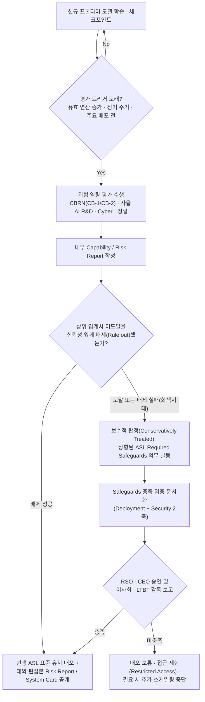
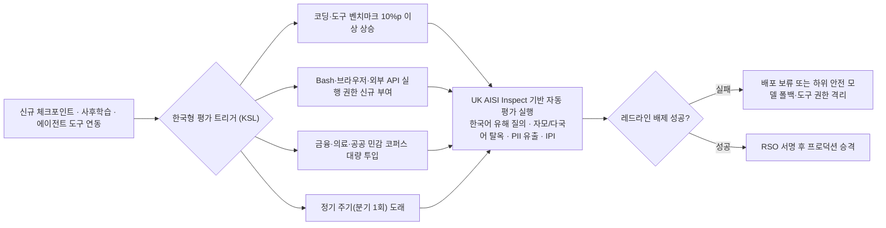

# [Week 02] Anthropic Responsible Scaling Policy (RSP v1→v2→v3) & ASL 프레임워크 심층 분석

- **리뷰 일자**: 2026-08-25 (화) *(2026-11-12 RSP v3.0 및 Opus 5 원문 대조 보강 완료)*
- **트랙/갈래**: Track 1 — RSP & Frontier Governance
- **난이도**: 🟡 중급
- **대상 문서 및 원문 링크**:
  - [Anthropic — Responsible Scaling Policy Hub & 현행 전문](https://www.anthropic.com/responsible-scaling-policy) — **본 리뷰의 현행 정책 허브**
  - [Anthropic — Responsible Scaling Policy v3 공지 (2026-02-24 발효)](https://www.anthropic.com/news/responsible-scaling-policy-v3) — **v3 개편 1차 사료**
  - [Anthropic — Responsible Scaling Policy v2 개정 공지 (2024-10)](https://www.anthropic.com/news/announcing-our-updated-responsible-scaling-policy) · [v1 원문 공지 (2023-09)](https://www.anthropic.com/news/anthropics-responsible-scaling-policy)
  - [Anthropic — System Card: Claude Opus 5 (2026-07-24, 193p PDF) §2 RSP Evaluations](https://www-cdn.anthropic.com/c5fbac3f0b1280a933ebd26d3cb8bb9f5bdeaf48/Claude%20Opus%205%20System%20Card.pdf) — **실집행 판정 1차 사료 (`CB-1` / `CB-2` / `AI R&D` / `ASL-3`)**
  - 비교 사료: [OpenAI Preparedness Framework v2 (2025-04-15 PDF)](https://cdn.openai.com/pdf/18a02b5d-6b67-4cec-ab64-68cdfbddebcd/preparedness-framework-v2.pdf), [Google DeepMind Frontier Safety Framework v3.1 (2026-04-17 PDF)](https://storage.googleapis.com/deepmind-media/DeepMind.com/Blog/strengthening-our-frontier-safety-framework/frontier-safety-framework_3-1.pdf)

> ✅ **사료 검증 및 보강 노트 (2026-11-12)**: 초판(2026-08-25)에 `[원문 대조 필요]`로 남겨 두었던 2026년 RSP 개편 내용을 **RSP v3(2026-02-24 발효)** 공식 문서 및 **Claude Opus 5 System Card(2026-07-24) §2** 원문과 직접 대조하여 확정했습니다. 아울러 §3.2의 3대 프론티어 랩 비교표도 OpenAI Preparedness v2 및 DeepMind FSF v3.1 원문 기준으로 정합성을 맞췄습니다.

---

## 1. 핵심 요약 (Executive Summary)

RSP(Responsible Scaling Policy)는 "차세대 모델이 얼마나 위험해질지 학습 전에 미리 알 수 없다"는 근본적 불확실성을 **조건부 공약(if-then commitments)** 으로 해결하는 거버넌스 장치입니다. 위험을 사전에 추측해 일률적으로 규제하는 대신, *"모델이 특정 위험 역량 임계치(Capability Threshold)를 넘었다는 가능성을 배제하지 못하면, 그 시점에 사전 정의된 배포·보안 표준(ASL Required Safeguards)을 충족하기 전까지 배포·추가 확장을 멈춘다"* 는 절차적 계약을 겁니다.

2023년 9월 v1 출범 이후 **v2(2024-10)** 에서 역량 임계치와 요구 안전조치를 분리하고 책임자(RSO)를 명문화했으며, **2026년 2월 발효된 v3** 에서는 (1) **Anthropic 단독 이행 공약과 산업계 공동 권고 사항의 분리**, (2) 화학·생물 위험의 **`CB-1`(비신규 무기 조력 → `ASL-3`) / `CB-2`(희소 전문성 대체)** 세분화 및 AI R&D 임계치의 **2계층 분리(초급 연구 자동화 vs 실효 스케일링 극적 가속)**, (3) **공개 Risk Report 발행 의무화 및 Long-Term Benefit Trust(LTBT)의 외부 감사 요청권**까지 제도화하며 실집행 체계를 완성했습니다.

- **핵심 목표**: 프론티어 모델의 재앙적 오용·통제 상실 위험을 **역량 수준에 비례한 단계적 보호 표준(ASL)** 으로 통제하고, 그 판정과 집행 책임을 제품 일정 압박으로부터 독립된 거버넌스 기구(RSO · 이사회 · LTBT)에 고정한다.
- **주요 제안/발견**:
  1. **ASL은 '모델의 역량 등급'이 아니라 '모델에 적용해야 할 안전 표준의 등급'이다**: 예컨대 `Claude Opus 5`를 `ASL-3`로 다룬다는 것은 `CB-1` 역량 보유 가능성을 보수적으로 인정하여 `ASL-3` 배포·보안 보호조치를 적용해 운영한다는 뜻이다.
  2. **안전조치는 반드시 배포 표준(Deployment Standard)과 보안 표준(Security Standard)의 두 축으로 쪼개진다**: 외부 사용자의 오용을 막는 가드레일과, 비국가·국가급 공격자로부터 모델 가중치(Weights) 탈취를 막는 인프라는 완전히 다른 공학 문제이기 때문이다.
  3. **RSP v3(2026)는 '회색지대(grey zone)'와 '일방적 속도전 딜레마'를 정면으로 다뤘다**: 단독 기업이 감당 가능한 공약과 정부·업계 공조가 필요한 영역을 투명하게 가르고, 주요 배포마다 공개 **Risk Report** 발행과 LTBT의 독립 외부 검토 권한을 명문화했다.
- **핵심 키워드**: `#RSPv3` `#ASL3` `#CapabilityThreshold` `#CB1_CB2` `#DeploymentVsSecurity` `#RiskReport` `#ResponsibleScalingOfficer`

---

## 2. 세부 내용 분석 (In-depth Technical Analysis)

### 2.1 ASL 계층 구조와 조건부 공약 메커니즘

#### (1) ASL (AI Safety Levels) 4단계 정의

| 레벨 | 정의 | 요구 조치의 성격 |
| :--- | :--- | :--- |
| **ASL-1** | 유의미한 재앙적 위험이 없는 시스템 (예: 체스 엔진, 구형 소형 언어모델) | 별도 추가 조치 불필요 |
| **ASL-2** | 위험 정보를 일부 생성할 수 있으나, 기존 검색엔진·교과서 대비 **유의미한 증분 위험(uplift)이 없는** 수준 | 기본선(baseline): 유해 요청 거부 학습, 시스템 카드 공개, 취약점 제보 창구, 표준 정보보안 위생 |
| **ASL-3** | 자원이 제한된 행위자에게 **실질적 증분 역량을 제공(`CB-1` 등)** 하거나 낮은 수준의 자율 위협 역량을 보이는 수준 | **강화된 다층 배포 방어**(실시간 활성값 프로브 + 헌법 분류기 + 신속 패치) + **비국가 행위자·내부자로부터 가중치 탈취를 막는 강화 보안** |
| **ASL-4 이상** | 신규 대량살상무기 개발의 희소 전문성을 대체(`CB-2`)하거나 **실효 스케일링 속도를 극적으로 가속**해 통제 곤란을 유발할 수 있는 수준 | 국가급(State-level) 행위자 방어 가중치 보안 + 정성·정량 종합 **긍정적 안전 논증(Affirmative Safety Case)** 완비 전 배포·확장 제한 |

> **핵심 해석**: ASL은 누적적(cumulative)이며, 동일 가중치라도 배포 형태에 따라 요구 조치가 달라집니다. 실제로 Week 05에서 분석한 `Claude Fable 5`(일반 공개, 분류기 발동 시 `Opus 4.8` 폴백)와 `Claude Mythos 5`(검증된 방어자 대상 제한 접근 + 30일 모니터링 보존)는 동일 베이스 모델 위에 배포 통제만 차등 구성한 사례입니다.

#### (2) RSP 판단·집행 워크플로 (v2~v3 기준)

설계상 가장 중요한 지점은 **`E` 노드의 입증 책임 전환**입니다. RSP는 "위험하다는 결정적 증거가 나올 때만 막는다"가 아니라, **"임계치 미도달을 충분한 신뢰도로 배제하지 못하면 보유한 것으로 보수적 간주(conservatively treated as having the capability)한다"** 는 예방 원칙을 택합니다. 실제로 `Claude Opus 5 System Card`(2026-07, §2)에서도 `CB-1` 역량을 이 보수적 간주 원칙에 따라 보유한 것으로 취급하여 `ASL-3` 보호조치를 유지했습니다.

#### (3) RSP v3(2026)의 추적 역량 임계치 세분화 (`CB-1`/`CB-2` 및 `AI R&D` 2계층)

초기 RSP에서 단일 덩어리로 묶여 회색지대 판정 논란을 낳았던 위협 벡터들은 v3 체제와 2026년 시스템 카드(`Opus 5` §2)에서 다음과 같이 정교하게 쪼개졌습니다.

| 위협 도메인 | 세부 임계치 구분 (RSP v3 & Opus 5 §2 기준) | 실질 위협 모델 정의 | 요구 보호 등급 |
| :--- | :--- | :--- | :--- |
| **화학·생물 (CBRN)** | **CB-1** (무기화·합성 조력) | 기초 STEM 배경을 가진 비전문가·중간 자원 행위자가 기존에 알려진 생물·화학 무기를 획득·합성·전달하는 데 유의미한 증분 조력을 제공 (`Opus 5`: 보유 간주) | **ASL-3** 배포 + 보안 |
| | **CB-2** (신규 개발·희소 전문성 대체) | 신규 병원체·작용제 설계나 핵심 병목 해결에서 고급 전문가를 대체해 국가·준국가 프로그램을 실질 가속 (`Opus 5`: 미도달, RNA 서열·AAV 캡시드 평가로 배제) | **ASL-4급** 상위 보호 |
| **자율 AI R&D** | **Tier 1: 초급 AI 연구 업무 완전 자동화** | 주니어 연구원·엔지니어 수준의 과업을 엔드투엔드로 대체 (경제·노동 및 보안 표면 확대 함의) | 상향된 보안 + 내부 통제 |
| | **Tier 2: 실효 스케일링 속도의 극적 가속** | 모델이 자체 AI R&D 루프를 비선형적으로 가속해 인간 감독 속도를 추월할 위험 (`Opus 5`: 미도달) | 최고 수준 보안 + Safety Case |
| **사이버 공세 (Cyber)** | 취약점 발굴 vs 익스플로잇 실행 분리 추적 | 오픈소스/상용 코드 취약점 탐색(`ExploitBench`, `OSS-Fuzz`) 및 다단계 침투(`CyScenarioBench`) 증분 효과 | 2단 분류기(활성값 프로브 + LLM 분류기) 및 방어자 예외(`CVP`) |

---

### 2.2 완화 조치(Mitigations)의 2축 분리와 거버넌스 장치

1. **배포 표준 (Deployment Standard — "오용을 막는다")**:
   - **다층 실시간 방어**: 헌법적 정렬(CAI) → 1단 내부 활성값(activations) 프로브 전량 스크리닝 → 플래그 시 2단 헌법 분류기(Constitutional Classifier) 정밀 판정 → 차단 또는 하위 안전 모델(`Opus 4.8`) 폴백.
   - **탐지–패치 회전율 SLA**: 단일 가드레일의 무결성을 가정하지 않고 외부 레드팀(`Trajectory Labs`, `Gray Swan` 등)·버그바운티와 신속 분류기 핫픽스를 결합.
2. **보안 표준 (Security Standard — "가중치를 지킨다")**:
   - 아무리 정교한 배포 가드레일도 모델 가중치가 유출되면 수 시간의 파인튜닝으로 벗겨집니다. `ASL-3` 보안 표준은 **비국가 범죄조직·정교한 내부자 위협**을 명시적 방어 범위로 설정하고, 가중치 접근 **2인 통제(two-party control)**, 이그레스 대역폭 제한, 신뢰 실행 환경 격리, 침투 테스트를 강제합니다.
3. **거버넌스 및 외부 감시 (RSP v2 → v3 강화분)**:
   - **RSO(Responsible Scaling Officer)** 와 제품 조직의 보고 라인 분리.
   - 주요 프론티어 모델 출시 시 내부 원본과 대외 편집본 **Risk Report** 발행 의무화(편집 영역 명시) 및 **Long-Term Benefit Trust(LTBT)** 의 외부 독립 감사인 지정·검토 요청 권한 부여.

---

## 3. 최근 동향 및 진화 과정 (Recent Evolution & 3대 랩 비교)

### 3.1 RSP v1 → v2 → v3 진화 요약

| 구분 | v1 (2023-09) | v2 (2024-10) | **v3 (2026-02 발효 ~ 2026 중반 개정)** |
| :--- | :--- | :--- | :--- |
| **정책 구조** | ASL 레벨에 역량·조치 혼재 | **Capability Threshold ↔ Required Safeguards 분리** | **자사 단독 공약(Commitments)과 산업계 공동 권고 분리** + 회색지대 판정 규율 정교화 |
| **핵심 임계치** | CBRN · Cyber · 자율 복제 개괄 정의 | CBRN · 자율 AI R&D · Cyber | **CBRN(`CB-1`/`CB-2`) 세분화** 및 **AI R&D 2계층(주니어 자동화 vs 스케일링 가속) 분리** |
| **문서화·투명성** | 내부 서술 중심 | Capability / Safeguards Report 내부 의무화 | 주요 배포마다 **공개 Risk Report 발행 의무화** 및 최소 사내 공유 인원 기준 명문화 |
| **거버넌스·집행** | 미발동 (선언 단계) | RSO 지정 · 이사회 보고 | **ASL-3 상용 실집행 정착**(2025 Opus 4 → 2026 Fable/Mythos/Opus 5) + **LTBT 외부 감사 요청권** |

### 3.2 2026년 기준 3대 프론티어 랩 안전 프레임워크 1:1:1 정밀 비교

| 비교 항목 | Anthropic **RSP v3** (2026-02) | OpenAI **Preparedness Framework v2** (2025-04) | Google DeepMind **FSF v3.1** (2026-04) |
| :--- | :--- | :--- | :--- |
| **등급 체계의 성격** | **요구 안전 표준의 등급** (`ASL-1~4`) | **3대 추적 범주별 역량 임계치** (`High` / `Critical`) + 연구 범주 | **4대 도메인별 3단 사다리** (`TCL` → `Alert Threshold` → `CCL`) |
| **핵심 추적 도메인** | CBRN(`CB-1`/`CB-2`), 자율 AI R&D(2계층), Cyber | Biological & Chemical, Cybersecurity, AI Self-Improvement *(+ 5대 연구 범주)* | CBRN, Cyber, Harmful Manipulation, ML R&D / Misalignment(Stealth·상황인식) |
| **고위험 역량 도달 시 배포 조건** | 해당 임계치에 매핑된 상위 ASL(예: `ASL-3` 배포+보안) 완전 충족 시 배포 | `High` 도달 시 위험을 **충분히 최소화(sufficiently minimize)** 하는 맞춤형 세이프가드 입증 후 배포 (`Critical`은 안전 입증 전 배포 금지) | `TCL`은 비례적 완화, `Alert`는 대응 계획 가동, `CCL`은 **Safety Case + RAND 보안 등급(SL2+~SL4)** 필수 |
| **입증 책임 기본값** | **배제 실패 시 보유로 보수적 간주** | 역량 벤치마크 임계치 초과 여부 + Safeguards Report 심의 | 다음 정기 평가 전 CCL 도달을 막는 **안전 버퍼(Alert Threshold)** 운용 |
| **거버넌스 기구** | RSO + CEO + 이사회 + **LTBT(외부 감사 요청권)** | Preparedness Team + **SAG(Safety Advisory Group)** + Leadership/Board | 내부 거버넌스 위험 수용 판정 + AGI Safety Council 연계 |

> **벤치마킹 결론**: 세 프레임워크 모두 2025~2026년 개정을 거치며 **"고위험 역량 모델의 무조건 배포 금지"가 아니라 "역량 임계치에 비례하는 다층 세이프가드·가중치 보안·공식 입증 문서(Risk/Safeguards Report, Safety Case)의 강제 결합"** 으로 수렴했습니다.

---

## 4. 🇰🇷 한국 독자 파운데이션 모델(Sovereign AI) 개발 관점 시사점

### 4.1 리소스 및 인프라 현실성: 버릴 것과 남길 것의 명확한 구분

| RSP 구성요소 | 소버린 AI 이식 판단 | 실무 근거 |
| :--- | :---: | :--- |
| **입증 책임 전환 (배제 실패 = 위험 간주)** | ✅ **즉시 채택** | 추가 인프라 비용 0원. 일정 압박 속에서 안전팀이 보수적 기본값을 지킬 수 있는 핵심 원칙 |
| **배포 표준 / 가중치 보안 표준 2축 분리** | ✅ **즉시 채택** | 가드레일 팀(서빙)과 인프라 보안 팀(가중치 탈취 방어)의 책임을 분리해 사각지대 제거 |
| **Capability Report / Safeguards Report 분리** | ✅ **경량화 채택** | "가드레일이 있으니 모델 자체도 안전하다"는 순환 논증을 막는 A4 2~3매 분리 양식 |
| **독립 RSO 지정** | ✅ **겸직 채택** | 전담 조직 없이도 **제품 출시 일정 KPI를 갖지 않는 임원(CISO/CLO 등)** 이 겸직하면 작동 |
| **습식 생물학(CBRN) 자체 실험 평가** | ⚠️ **외부·공개 벤치 대체** | 국내 모델사가 자체 습식 실험실을 운영할 수 없으므로 공개 벤치마크 + Korea AISI 협력으로 대체 |
| **사전학습 연산량 배수 트리거** | ❌ **역량 델타 트리거로 치환** | 파인튜닝·증류·도구 결합만으로도 위험 역량이 급등하므로 연산량 대신 **기능·점수 변화량**을 트리거로 사용 |

### 4.2 한국어 및 국내 법제도(인공지능기본법) 매핑
- **위협 지형의 현지화**: 국내 모델의 실질적 `ASL-3`급 사고는 생물무기보다 **① 한국어 보이스피싱·맞춤형 금융사기 자동화, ② 주민등록번호·계좌 등 고유식별정보 유출, ③ 사내/공공망 연동 에이전트의 간접 프롬프트 인젝션(IPI)** 에서 먼저 터집니다.
- **「인공지능기본법」(2026. 1. 22. 시행)과의 문서 일원화**: 법률 **제32조**(누적 연산량 $10^{26}$ FLOPs 이상 고성능 AI 안전성 확보 의무) 및 **제34조**(고영향 AI 사업자의 위험관리방안·설명 방안·사람의 관리감독·문서 보관 의무)가 요구하는 증빙은 RSP의 `Risk Report + Safeguards Report` 구조와 정확히 겹칩니다. 규제 제출용 문서와 내부 안전 심의 문서를 이중 작성하지 말고 단일 파이프라인에서 생성해야 합니다(상세 조문 매핑은 [Week 14 리뷰](../week-14/review_week14.md) 참조).

### 4.3 우리 팀이 당장 적용할 Action Item (Top 3)
1. **[단기/즉시] 경량 RSP 정책서([`lightweight_rsp_blueprint.md`](../../resources/lightweight_rsp_blueprint.md)) 및 독립 승인권자(겸직 RSO) 지정**: 국내 4대 레드라인, 역량 변화량 기반 평가 트리거, 제품 조직 외부의 배포 거부권자를 1페이지 규정에 명시.
2. **[중기/학습·평가] `Inspect` 기반 한국어 KSL 자동 게이트 구축**: 체크포인트 승격 CI에 한국어 유해 요청·교차언어/자모 탈옥·PII 노출·에이전트 IPI 태스크를 연결해 미통과 시 배포 아티팩트 승격 차단.
3. **[배포/운영] 가중치 2인 통제(Two-Party Control) 및 이중 트랙 서빙 설계**: 가중치 파일 반출·적재 시 2인 결재를 강제하고, 고위험 플래그 세션은 거부 대신 안전한 하위/제한 모드로 자동 폴백(`Fable 5` 패턴)하도록 게이트웨이 구성.

---

## 5. 논의할 질문 (Discussion Questions & Open Issues)
- **Q1.** 상업적 출시 압박과 충돌할 때 "배포 보류"를 실제로 작동시키는 힘은 문서 문구인가, RSO·이사회·LTBT 같은 권력 분립 거버넌스인가? 이사회 내 안전 전문기구가 없는 국내 기업이 실질적 견제력을 확보하는 현실적 대안은 무엇인가?
- **Q2.** "배제 실패 시 위험 보유로 간주한다"는 보수적 원칙은 평가 설계 역량이 부족한 팀일수록 모든 모델을 위험 등급으로 오판하게 만드는 역설을 낳는다. 평가 정밀도가 낮을 때 보수성과 실용성의 균형을 어떻게 잡을 것인가?
- **Q3.** RSP v3처럼 내부 원본 보고서와 대외 공개 편집본(Redacted Risk Report)을 이원화할 때, 정보 해자(information hazard) 비공개와 외부 검증 투명성 사이의 기준을 누가 검증할 것인가?

---

## 6. 참고 문헌 및 검증된 원문 링크
- Anthropic. *Responsible Scaling Policy Hub*. [공식 허브](https://www.anthropic.com/responsible-scaling-policy)
- Anthropic (2026-02-24). *Anthropic's Responsible Scaling Policy: Version 3*. [공식 공지](https://www.anthropic.com/news/responsible-scaling-policy-v3)
- Anthropic (2024-10). *Announcing our updated Responsible Scaling Policy (v2)*. [공식 공지](https://www.anthropic.com/news/announcing-our-updated-responsible-scaling-policy)
- Anthropic (2023-09). *Anthropic's Responsible Scaling Policy (v1)*. [공식 공지](https://www.anthropic.com/news/anthropics-responsible-scaling-policy)
- Anthropic (2026-07-24). *System Card: Claude Opus 5* (193p PDF, §2 RSP Evaluations). [원문 PDF](https://www-cdn.anthropic.com/c5fbac3f0b1280a933ebd26d3cb8bb9f5bdeaf48/Claude%20Opus%205%20System%20Card.pdf)
- OpenAI (2025-04-15). *Preparedness Framework Version 2* (PDF). [원문 PDF](https://cdn.openai.com/pdf/18a02b5d-6b67-4cec-ab64-68cdfbddebcd/preparedness-framework-v2.pdf)
- Google DeepMind (2026-04-17). *Frontier Safety Framework v3.1* (20p PDF). [원문 PDF](https://storage.googleapis.com/deepmind-media/DeepMind.com/Blog/strengthening-our-frontier-safety-framework/frontier-safety-framework_3-1.pdf)
- UK AI Security Institute. *Inspect — Open-source Evaluation Framework*. [공식 사이트](https://inspect.aisi.org.uk/)
- 국가법령정보센터. 「인공지능 발전과 신뢰 기반 조성 등에 관한 기본법」(법률 제20676호, 2026. 1. 22. 시행). [법령 원문](https://www.law.go.kr/법령/인공지능발전과신뢰기반조성등에관한기본법)
