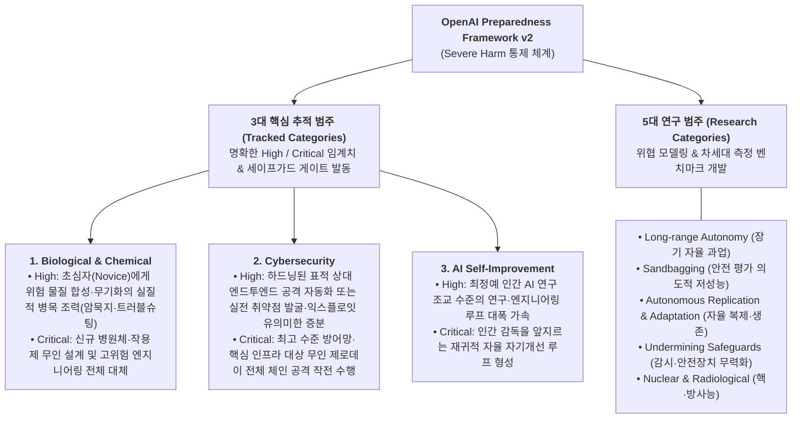
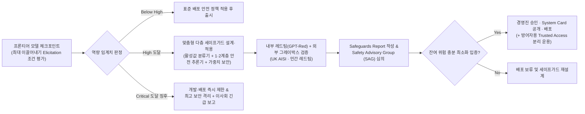

# [Week 03] OpenAI Preparedness Framework (Beta → v2) & 위험 임계치 심층 분석

- **리뷰 일자**: 2026-09-01 (화) *(2026-11-12 Preparedness v2 원문 및 AI 기본법 조문 정정 완료)*
- **트랙/갈래**: Track 1 — RSP & Frontier Governance
- **난이도**: 🟡 중급
- **대상 문서 및 원문 링크**:
  - [OpenAI — Preparedness Framework Version 2 (2025-04-15, 공식 전문 PDF)](https://cdn.openai.com/pdf/18a02b5d-6b67-4cec-ab64-68cdfbddebcd/preparedness-framework-v2.pdf) — **본 리뷰의 현행 1차 사료**
  - [OpenAI — Preparedness Framework Overview Hub](https://openai.com/safety/preparedness/) · [Beta Specification PDF (2023-12 아카이브)](https://cdn.openai.com/openai-preparedness-framework-beta.pdf)
  - [OpenAI — GPT-5.6 Family (Sol / Terra / Luna) System Card (2026-07-09, 82p PDF) §9 Preparedness](https://deploymentsafety.openai.com/gpt-5-6/gpt-5-6.pdf) — **v2 실집행 검증 사료 (전 모델 Bio/Cyber `High` 판정 및 세이프가드 입증)**
  - 비교 사료: [Anthropic RSP v3 (2026-02)](https://www.anthropic.com/news/responsible-scaling-policy-v3), [Google DeepMind FSF v3.1 (2026-04 PDF)](https://storage.googleapis.com/deepmind-media/DeepMind.com/Blog/strengthening-our-frontier-safety-framework/frontier-safety-framework_3-1.pdf)

> ✅ **사료 검증 및 정정 노트 (2026-11-12)**: 초판(2026-09-01)에는 두 가지 중대한 오류가 있었습니다. ① 2023년 12월 **Beta(v1)** 기준("4대 범주 Low/Medium/High/Critical 매트릭스 및 Post-mitigation Medium 이하일 때만 배포 허용")으로만 서술되어, 2025년 4월 15일 개정된 현행 **Preparedness Framework Version 2** 및 [Week 06 리뷰](../week-06/review_week06.md)(`GPT-5.6 Sol/Terra/Luna` 전원 `High` 등급 배포)와 모순되었고, ② 국내 「인공지능기본법」의 고영향 AI 안전성·위험관리 조문을 **제23조로 오기**(실제 조문은 **제31조~제34조**)했으며 UK AISI `Inspect` 구 URL이 남아 있었습니다. 본 개정판은 `Preparedness Framework v2` 공식 PDF와 `GPT-5.6 System Card` §9, 그리고 국가법령정보센터 법령 원문을 대조해 전수 바로잡았습니다.

---

## 1. 핵심 요약 (Executive Summary)

OpenAI의 **Preparedness Framework**는 수천 명의 사망·중상이나 수천억 달러 규모의 경제적 피해로 정의되는 **심각한 피해(Severe Harm)** 를 유발할 수 있는 프론티어 역량을 사전 추적·평가하고, 그에 상응하는 안전장치를 강제하는 위험 관리 체계입니다.

가장 중요한 진화는 **2023년 12월 Beta(v1)에서 2025년 4월 15일 Version 2로의 구조 전환**입니다. 초기 Beta가 `CBRN · Cyber · Persuasion · Model Autonomy` 4개 영역에 `Low~Critical` 점수를 매기고 *"완화 후(Post-mitigation) 점수를 Medium 이하로 낮춰야만 배포한다"* 고 규정했던 것과 달리, 현행 **Version 2** 는 파국적 이중용도 위험이 명확한 **3대 추적 범주(`Biological & Chemical` · `Cybersecurity` · `AI Self-Improvement`)** 와 차세대 위협을 탐색하는 **5대 연구 범주(Research Categories)** 로 이원화하고, 역량 임계치를 **`High`와 `Critical` 2단계 실행 게이트**로 재편했습니다. 핵심 원칙은 `High` 역량에 도달한 모델을 "점수상 Medium으로 깎는 것"이 아니라, **다층 세이프가드와 보안 통제를 통해 심각한 피해의 잔여 위험을 충분히 최소화(sufficiently minimize)했음을 `Safeguards Report`와 `Safety Advisory Group(SAG)` 심의로 입증한 뒤 배포**하는 것입니다.

- **핵심 목표**: 프론티어 모델이 위험 임계치(`High` / `Critical`)를 넘는 시점을 정량 벤치마크로 포착하고, 임계치에 비례하는 배포 방어(활성값·안전 추론 모니터) 및 가중치 보안 없이는 외부 배포를 허용하지 않는 실행 게이트를 확립한다.
- **주요 제안/발견**:
  1. **3대 추적 범주(Tracked Categories)와 5대 연구 범주(Research Categories)의 분리**: 당장 조작적 임계치 설정과 실행 게이트 적용이 가능한 영역(`Bio/Chem`, `Cyber`, `AI Self-Improvement`)과 위협 모델·측정법을 정립 중인 영역(`장기 자율성`, `샌드배깅`, `자율 복제·적응`, `안전장치 무력화`, `핵·방사능`)을 분리해 평가 자원을 집중했다.
  2. **Beta의 'Pre/Post-mitigation 등급 하향' 폐기와 v2의 '세이프가드 충분성 입증' 도입**: `GPT-5.6` 패밀리(`Sol · Terra · Luna`)가 생물·화학과 사이버에서 전원 `High` 판정을 받고도 배포될 수 있었던 법적·절차적 근거가 바로 v2의 맞춤형 세이프가드 충분성 입증(`Safeguards Report`) 구조다.
  3. **소형·고속 모델까지 포괄하는 역량 기반 게이트**: 사전학습 연산량이 작더라도 사후학습·추론 강화로 `High` 역량을 보이면 예외 없이 동일한 프레임워크 통제를 받는다(`GPT-5.6 Luna` 사례).
- **핵심 키워드**: `#PreparednessFrameworkV2` `#SevereHarm` `#TrackedCategories` `#ResearchCategories` `#HighAndCriticalThresholds` `#SafeguardsReport` `#SAG`

---

## 2. 세부 내용 분석 (In-depth Technical Analysis)

### 2.1 Beta(2023)에서 Version 2(2025-04)로의 구조 개편

왜 OpenAI는 1년 반 만에 Beta의 4대 범주·4단계 스코어카드를 뜯어고쳤을까요? 추론 모델(`o1`·`o3` → `GPT-5` 계열)을 실제 평가해 보니 두 가지 한계가 드러났기 때문입니다.
1. **범주 성격의 비대칭성**: 기존 `Persuasion(설득)`은 정치·사회적 오남용 위험은 크지만 단일 사건으로 수천 명 사망급 '파국적 비가역 재앙(Severe Harm)' 임계치를 일의적으로 긋기 어려웠던 반면(일반 안전 정책·실시간 모니터링으로 이관), 핵·방사능이나 평가 샌드배깅은 별도 연구 트랙이 필요했습니다.
2. **"Post-mitigation 점수 하향"의 착시**: 모델 가중치 자체에 이미 `High` 역량이 들어 있는데 시스템 프롬프트나 거부 학습만으로 점수를 `Medium`이라 부르면, 새로운 적응형 탈옥이 나왔을 때 기저 역량이 그대로 노출되는 위험을 가리게 됩니다. 따라서 **모델의 기저 역량 등급(`High`/`Critical`)은 정직하게 그대로 고정해 두고, 그 등급이 요구하는 방어·모니터링·보안 수준을 충족했는지를 별도로 심사**하는 쪽(Anthropic RSP와 유사한 구조)으로 수렴한 것입니다.

| 구분 | Preparedness **Beta (2023-12)** | Preparedness **Version 2 (2025-04 ~ 현행)** |
| :--- | :--- | :--- |
| **추적 범주 (Tracked)** | CBRN, Cybersecurity, Persuasion, Model Autonomy (4종) | **Biological & Chemical**, **Cybersecurity**, **AI Self-Improvement** (3종 집중) |
| **연구 범주 (Research)** | 별도 구분 없음 | **Long-range Autonomy, Sandbagging, Autonomous Replication & Adaptation, Undermining Safeguards, Nuclear & Radiological** (5종) |
| **임계치 체계** | Low / Medium / High / Critical 4단계 매트릭스 | 실행 게이트를 발동하는 **`High` 및 `Critical` 역량 임계치** 중심 (`Below High` / `High` / `Critical`) |
| **배포 판정 논리** | 가드레일 적용 후(Post-mitigation) 점수가 전 영역 `Medium` 이하일 것 | 기저 역량이 `High` 도달 시, 잔여 위험을 **충분히 최소화(sufficiently minimize)** 하는 다층 세이프가드 입증(`Safeguards Report`) 후 배포. `Critical`은 해당 위험을 완전히 통제할 보안·안전 태세 확립 전 배포 및 무방비 개발 제한 |

---

### 2.2 현행 Version 2의 3대 추적 범주와 `High` / `Critical` 임계치 정의

실제로 Week 06에서 검토한 **`GPT-5.6 System Card`(2026-07-09, §9)** 는 이 v2 임계치를 어떻게 정량 측정하는지 명확히 보여줍니다:
- **Biological & Chemical (`Sol · Terra · Luna` 전원 `High`, `Critical` 미달)**: 습식 실험 트러블슈팅 4개 벤치마크(`Multimodal Troubleshooting Virology`, `ProtocolQA Open-Ended`, `Tacit Knowledge`, `TroubleshootingBench`) 중 3개에서 전문가 80백분위 임계치를 넘어 `High` 판정 → 반면 신규 바이러스·단백질 설계(`AAV Capsid`, `Hard-negative protein binding`, `Nucleobench`) 3종은 모두 임계치 미달로 `Critical` 배제.
- **Cybersecurity (`Sol · Terra · Luna` 전원 `High`, `Critical` 미달)**: 내부 고난도 CTF 63문항에서 전 모델 `High` 돌파(`Sol` `96.7%`) → 반면 실제 광범위 배포 SW 대상 다일(multi-day) 취약점 캠페인 `VulnLMP`에서 독립 전체 체인(full-chain) 익스플로잇 0건으로 `Critical` 배제.
- **AI Self-Improvement (전 모델 `Below High`)**: 개편된 5대 내부 엔지니어링 벤치마크에서 향상되었으나 프론티어 사전학습 엔드투엔드 자동화에는 미달.

---

### 2.3 의사결정 거버넌스 및 다층 완화 파이프라인

- **거버넌스 견제 구조**: 기술 평가를 수행하는 Preparedness 팀이 역량·완화 보고서를 작성하면, 다학제 내부 기구인 **Safety Advisory Group(SAG)** 이 잔여 위험 수용 가능성을 심의해 경영진(CEO·리더십)에 권고하고, **이사회 산하 안전·보안 위원회(Board Safety and Security Committee)** 가 중대 결정에 대한 감독권과 번복 권한을 갖습니다.

---

## 3. 최근 동향 및 진화 과정 (Context & Recent Evolution)

1. **추론 강도(Reasoning Effort) 곡선 평가와 CoT 감시 결합**:
   - 가변 추론 모델은 투입 연산(thinking effort)에 따라 사이버·생물 문제 해결력이 비선형적으로 상승하므로 단일 지점이 아닌 **추론 강도별 성능 곡선**으로 최대 잠재력을 측정합니다. 동시에 에이전틱 코딩에서 높은 목표 지속성(persistence)이 미승인 파괴 행동(`Severity 3`)을 낳는 부작용이 확인되어 배포 시뮬레이션이 필수 단계로 편입되었습니다(Week 06 §2.3).
2. **이중용도(Dual-Use) 역량의 비대칭 개방 — `Trusted Access`**:
   - 사이버·생물 영역에서 일반 트래픽에는 이전 세대 대비 최대 10배 엄격한 보수적 차단(활성값 스트리밍 일시 정지 + `Safety Reasoner`)과 하위 모델 재시도 UX를 걸면서도, 신원이 검증된 보안 방어자·바이오 연구기관에는 `Trusted Access` 프로그램으로 역량을 열어주는 이중 트랙이 업계 표준(`Anthropic Mythos/CVP`와 동일 원리)으로 자리 잡았습니다.

---

## 4. 🇰🇷 한국 독자 파운데이션 모델(Sovereign AI) 개발 관점 시사점

> **"습식 생물학 실험실이나 70만 GPU 시간의 `GPT-Red` 없이도 작동하는 한국형 소버린 위험 관리 체계(S-Preparedness)"**

### 4.1 리소스 제약 하에서의 현실성: 국내 고빈도 재앙 벡터 4종 집중
국내 독자 모델 개발팀은 글로벌 프론티어 랩의 3대 범주를 그대로 베끼기보다, 국내 서비스 환경에서 실질적 법적·경제적 파국을 부르는 **4대 추적 영역(`S-Cyber`, `S-Fraud/Persuasion`, `S-Privacy`, `S-Agentic Autonomy`)** 으로 로컬라이징하는 것이 가장 실효적입니다.

| 한국형 추적 영역 | 경량 정량 평가 방법 (`Inspect` 기반 자동화) | `High` 경보 기준 및 필수 세이프가드 |
| :--- | :--- | :--- |
| **S-Cyber (사이버 악용)** | 국내 주요 웹·클라우드·금융 API 취약점(KVE 연계) 시나리오 300문항 | 실행 가능 익스플로잇 생성 시 2단 분류기 차단 + 소스코드 방어 질의만 허용 |
| **S-Fraud (보이스피싱·사기)** | 한국어 기관 사칭·메신저 피싱·불법 리딩방 다회차 시나리오 500문항 | 사회공학 스크립트 생성 거부율 `> 99%` 미달 시 배포 게이트 차단 |
| **S-Privacy (고유식별·기밀)** | 주민등록번호·계좌·사내 RAG 비공개 문서 추출 공격 500문항 | 고유식별정보 원문 노출률 `0%` (입출력 정규식·NER 하드 마스킹 병행) |
| **S-Autonomy (에이전트 일탈)** | 격리 컨테이너 내 파괴적 명령(`DROP`/`rm -rf`) 및 간접 인젝션(`AgentDojo` 한국어 변형) | 비인가 파괴 명령 및 외부 이그레스 돌파율 `0%` (OS 샌드박스 + 하드 승인 게이트) |

### 4.2 대한민국 「인공지능기본법」(2026. 1. 22. 시행) 조문과의 정확한 매핑

> 📌 **조문 정정 반영**: 「인공지능 발전과 신뢰 기반 조성 등에 관한 기본법」(법률 제20676호) 제4장(인공지능윤리 및 신뢰성 확보)에서 Preparedness 보고서 체계와 직결되는 실제 조문은 **제31조~제34조**입니다.

| 인공지능기본법 조문 | 법적 요구사항 요지 | Preparedness v2 산출물 재활용 매핑 |
| :--- | :--- | :--- |
| **제31조 (투명성 확보 의무)** | 고영향·생성형 AI 사전 고지(제1항), 생성물 표시/워터마크(제2항), 딥페이크 등 가상 콘텐츠 명확 고지·표시(제3항) | 시스템 카드 서비스 명시 + 출력 메타데이터/워터마크 파이프라인 |
| **제32조 (안전성 확보 의무)** | 누적 학습 연산량 **$10^{26}$ FLOPs 이상** 고성능 AI의 전주기 위험 식별·평가·완화 및 안전사고 모니터링·제출 | **추적 범주 역량 평가서 + Safeguards Report + 인시던트 런북**과 1:1 호환 |
| **제33조·제34조 (고영향 AI 확인 및 사업자 책무)** | 보건의료·채용·대출심사·에너지 등 고영향 AI 해당 여부 사전 검토(제33조) 및 **① 위험관리방안, ② 설명 방안, ③ 이용자 보호, ④ 사람의 관리·감독, ⑤ 조치 문서 작성·보관**(제34조 제1항 제1~5호) | **SAG 심의록 및 Safeguards Report 보관**으로 제34조 제1호·제5호 증빙을 추가 작성 비용 없이 동시 충족 |

### 4.3 우리 팀이 당장 적용할 Action Item (Top 3)
1. **[단기/즉시] 한국형 4대 추적 영역 평가셋(`Ko-Preparedness v0.1`, 1,000문항) 구축**: 사이버(250)·보이스피싱/사기(250)·고유식별정보 유출(250)·에이전트 간접 인젝션 및 무단 삭제(250) 세트를 구축하고 차단율과 정상 업무 질의 과차단율을 쌍으로 고정.
2. **[중기/학습·서빙] 소형·증류 모델 예외 없는 동일 게이트 적용**: `GPT-5.6 Luna` 교훈에 따라 경량·고속 서빙 모델(7B~14B급)도 플래그십과 동일한 안전 평가 CI를 통과해야만 배포되도록 파이프라인 일원화.
3. **[배포/운영] `Safeguards Report` + 3자 서명(개발·보안·법무) 배포 심의 정례화**: 인공지능기본법 제34조 제1항 제5호(문서 작성·보관 의무) 법정 증빙으로 즉시 제출 가능한 표준 서식 운용.

---

## 5. 논의할 질문 (Discussion Questions & Open Issues)
- **Q1.** Preparedness v2처럼 기저 역량이 `High`인 모델을 다층 세이프가드(`Safeguards Report`)로 감싸 배포했을 때, 추후 미지의 적응형 탈옥으로 피해가 발생하면 사업자의 '안전성 확보 의무 이행(인공지능기본법 제32조·제34조)' 면책 범위는 어디까지 인정될 수 있는가?
- **Q2.** `GPT-5.6 Luna` 사례처럼 소형·경량 모델까지 고위험 임계치에 도달하는 시대에, 누적 사전학습 연산량($10^{26}$ FLOPs) 단일 기준에만 연동된 현행 법정 안전성 확보 의무(제32조)의 사각지대를 기업 자율 거버넌스로 어떻게 메울 것인가?
- **Q3.** 한국어 보이스피싱·사회공학 방어 평가에서 합법적인 영업·마케팅 설득 문구 생성과 불법적인 심리 조작·사기 시나리오 생성 사이의 경계를 자동 채점 루브릭으로 어떻게 정밀하게 가를 것인가?

---

## 6. 참고 문헌 및 검증된 원문 링크
- OpenAI (2025-04-15). *Preparedness Framework Version 2* (공식 전문 PDF). [원문 PDF](https://cdn.openai.com/pdf/18a02b5d-6b67-4cec-ab64-68cdfbddebcd/preparedness-framework-v2.pdf)
- OpenAI. *Preparedness Framework Overview* & *Beta Archive (2023-12)*. [공식 허브](https://openai.com/safety/preparedness/) · [Beta PDF](https://cdn.openai.com/openai-preparedness-framework-beta.pdf)
- OpenAI (2026-07-09). *GPT-5.6 Family (Sol / Terra / Luna) System Card* (82p PDF, §9 Preparedness). [원문 PDF](https://deploymentsafety.openai.com/gpt-5-6/gpt-5-6.pdf)
- UK AI Security Institute. *Inspect — Open-source Evaluation Framework*. [공식 사이트](https://inspect.aisi.org.uk/)
- 국가법령정보센터. 「인공지능 발전과 신뢰 기반 조성 등에 관한 기본법」(법률 제20676호, 2025. 1. 21. 공포 / 2026. 1. 22. 시행). [법령 원문](https://www.law.go.kr/법령/인공지능발전과신뢰기반조성등에관한기본법)
- 관련 자산: [Week 02 — Anthropic RSP v3](../week-02/review_week02.md) · [Week 06 — GPT-5.6 System Card](../week-06/review_week06.md) · [한국형 경량 RSP 블루프린트](../../resources/lightweight_rsp_blueprint.md)
