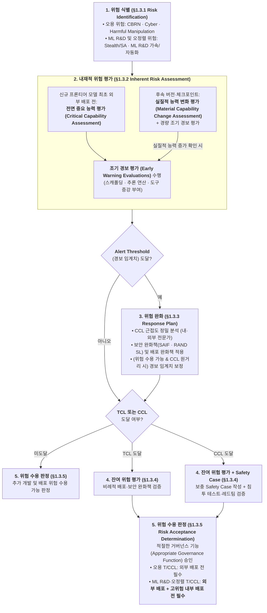
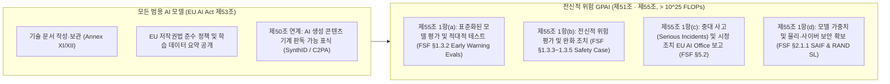

# [Week 04] Google DeepMind Frontier Safety Framework (FSF v3.1) & EU AI Act 컴플라이언스 심층 분석

- **리뷰 일자**: 2026-08-31 (월) · **원문 기준 전면 재작성**: 2026-10-19 (월)
- **트랙/갈래**: Track 1 — RSP & Frontier Governance (Track 1 종합 마무리)
- **난이도**: 🟡 중급
- **대상 문서 및 원문 링크**:
  - [Google DeepMind — Frontier Safety Framework v3.1 (2026-04-17, 20p PDF)](https://storage.googleapis.com/deepmind-media/DeepMind.com/Blog/strengthening-our-frontier-safety-framework/frontier-safety-framework_3-1.pdf) — **본 리뷰의 1차 사료**
  - [Google DeepMind — Strengthening our Frontier Safety Framework (v3.1 공식 블로그)](https://deepmind.google/blog/strengthening-our-frontier-safety-framework/) · [v3.0 발표 블로그 (2025-09-22)](https://deepmind.google/blog/updating-the-frontier-safety-framework/) · [v1.0 발표 블로그 (2024-05-17)](https://deepmind.google/discover/blog/introducing-the-frontier-safety-framework/)
  - [Google DeepMind — An Approach to Technical AGI Safety and Security (`arXiv:2504.01849`)](https://arxiv.org/abs/2504.01849) · [Evaluating Frontier Models for Stealth and Situational Awareness (`arXiv:2505.01420`)](https://arxiv.org/abs/2505.01420) — **FSF v3.1 각주 7·10·15 인용 기술 백서**
  - [RAND Corporation — Securing AI Model Weights (`RRA2849-1`)](https://www.rand.org/pubs/research_reports/RRA2849-1.html) — **FSF v3.1 보안 등급(`SL 2+/3/4`) 정렬 기준**
  - [European Union — EU AI Act (Regulation (EU) 2024/1689) 공식 전문](https://eur-lex.europa.eu/eli/reg/2024/1689/oj) · [탐색 포털](https://artificialintelligenceact.eu/)
  - [Google DeepMind — SynthID: Robust watermarking for AI-generated content](https://deepmind.google/technologies/synthid/)
  - 비교 사료: [Anthropic RSP](https://www.anthropic.com/news/announcing-our-updated-responsible-scaling-policy) · [OpenAI Preparedness Framework](https://cdn.openai.com/openai-preparedness-framework-beta.pdf) · [GPT-5.6 System Card](https://deploymentsafety.openai.com/gpt-5-6/gpt-5-6.pdf)

> ✅ **사료 검증 및 전면 재작성 노트 (2026-10-19)**: 초기 Week 04 리뷰(2026-08-31 작성)는 2차 요약에 의존하여 원문에 없는 용어(`Early Warning Thresholds (EWT)`), 비실재 수식($C_{EW} = C_{crit} - \Delta_{margin}$ 및 `연산량 6~10배 이전`), 부정확한 위험 범주 및 자체 보안 등급(`SL-1~4`)을 서술하는 오류가 있었습니다([Week 07 리뷰 §3.3](../week-07/review_week07.md) 참조). 본 문서는 **20페이지 분량의 `Frontier Safety Framework Version 3.1` (2026-04-17 공개) 원문 PDF 전체(§1~§5 및 Glossary)** 와 각주 인용 논문(`arXiv:2504.01849`, `arXiv:2505.01420`, `RAND RRA2849-1`)을 직접 대조하여 **100% 1차 사료 기준으로 전면 재작성**한 버전입니다. 실제 모델(`Gemini 3.7 Flash`)에 대한 FSF v3.1 판정 사례는 [Week 07 리뷰](../week-07/review_week07.md)에서 이어집니다.

---

## 1. 핵심 요약 (Executive Summary)

Google DeepMind의 **Frontier Safety Framework (FSF) Version 3.1**(2026년 4월 17일 발간)은 프론티어 AI 모델의 고영향(High-impact) 능력으로부터 발생할 수 있는 **심각한 위험(Severe Risks)** 과 **상당한 위험(Significant Risks)** 을 사전 식별·탐지·완화하기 위한 프로토콜 체계입니다. FSF는 2024년 5월 v1.0 도입 이후 v2.0(2025-02-04), v3.0(2025-09-22)을 거쳐 v3.1에 이르렀으며, **오용 위험(Misuse Risk: CBRN · Cyber · Harmful Manipulation)** 과 **기계학습 연구개발 및 오정렬 위험(ML R&D and Misalignment Risk)** 의 양대 축으로 구성됩니다.

초기 버전들이 파국적 피해가 발생하는 단일 임계치인 **Critical Capability Levels (CCLs)** 중심이었다면, **FSF v3.1**은 그보다 낮은 능력 수준에서 나타나는 상당한 위험을 포착하기 위해 **Tracked Capability Levels (TCLs)** 를 신설하고, 다음 정기 평가 주기 전에 CCL 도달 가능성을 조기에 포착하는 **경보 임계치(Alert Thresholds)** 와 결합하여 **3단 임계치 사다리(TCL → Alert Threshold → CCL)** 및 **5단계 위험 관리 프로세스(§1.3.1~§1.3.5)** 를 확립했습니다.

아울러 본 리뷰는 2026년 본격 적용된 **EU AI Act (Regulation (EU) 2024/1689)** 의 범용 AI(GPAI) 및 전신적 위험(Systemic Risk, 누적 학습 연산량 $10^{25}\text{ FLOPs}$ 이상) 의무 조항과 DeepMind의 **SynthID** 워터마킹을 연결하고, Track 1의 최종 결론으로서 **글로벌 3대 프론티어 랩(Anthropic RSP · OpenAI Preparedness · DeepMind FSF v3.1)의 거버넌스 아키텍처를 1차 사료 기준으로 통합 비교**합니다.

- **핵심 목표**: FSF v3.1의 **TCL · Alert Threshold · CCL** 3단 임계치 구조와 **5단계 위험 관리 프로세스**(위험 식별 → 내재적 위험 평가 → 위험 완화 → 잔여 위험 평가 및 Safety Case → 위험 수용 판정)를 원문 그대로 파악하고, EU AI Act 및 국내 인공지능기본법 대응을 위한 소버린 AI 거버넌스 설계안을 도출한다.
- **주요 제안/발견**:
  1. **평가 주기 기반의 안전 버퍼(Safety Buffer)와 경보 임계치(Alert Thresholds)**: FSF v3.1은 연산량 배수 공식이 아니라 **정기 평가 주기(Critical Capability Assessment Cycle)** 를 기준으로 안전 버퍼를 정의한다. 모델이 경보 임계치에 도달하면 CCL 근접도를 분석하고 **대응 계획(Response Plan)** 을 가동하되, 위험이 수용 가능하고 CCL과 거리가 멀다면 안전 버퍼 유지를 위해 경보 임계치 자체를 갱신할 수 있는 유연성을 둔다(§1.3.2~§1.3.3).
  2. **실질적 능력 변화 평가(Material Capability Change Assessment)를 통한 평가 효율화**: 최초 외부 배포 전에는 전면적인 **Critical Capability Assessment**를 수행하지만, 후속 체크포인트나 파생 버전은 포스트트레이닝 완료 시점에 **Material Capability Change Assessment** 및 경량화된 조기 경보 평가(Light-weight early warning evaluations)를 통해 '실질적 능력 증가(Material Capability Increase)'가 있는지 먼저 판별하여 재평가 여부를 결정한다(§1.3.2, Glossary p.19).
  3. **RAND 프레임워크에 정렬된 가중치 보안(`Security Level 2+ / 3 / 4`)과 고위험 내부 배포(High-Risk Internal Deployment) 규율**: 가중치 탈취 방어는 Google의 **SAIF(Secure AI Framework)** 및 **RAND 모델 가중치 보안 프레임워크(`RRA2849-1`)** 에 정렬되며, v3.1은 내부자 위협과 비국가 행위자를 방어하는 **`Security Level 2+`** 를 모든 오용 CCL(CBRN·Cyber·Harmful Manipulation)의 기본 권고 등급으로 상향했다(§2.1.1, §5.3). 반면 **ML R&D 및 오정렬 도메인**은 외부 배포뿐 아니라 **고위험 내부 배포(High-Risk Internal Deployments)** 까지 배포 완화책(CoT 모니터링 등)과 위험 수용 판정의 적용 대상으로 묶는다(§1.3.5, §3.1.2).
  4. **공공재(Global Public Good)로서의 조건부 보안 공약**: FSF는 특히 `ML R&D Automation Level 1 CCL`에 권고되는 `Security Level 4`와 같이 막대한 혁신 비용을 수반하는 완화책은 **프론티어 AI 업계 전체가 함께 채택할 때만 사회적 효용이 유지된다**고 명시하여, 일방적 규제 부담이 아닌 산업 전반의 공조(Industry-wide adoption)를 전제로 삼는다(Overview p.2, §2.2, §3.2.2).
- **핵심 키워드**: `#FSFv3_1` `#CriticalCapabilityLevels` `#TrackedCapabilityLevels` `#AlertThresholds` `#MaterialCapabilityIncreases` `#RANDSecurityLevel2Plus` `#SafetyCase` `#EUAIAct`

---

## 2. 세부 내용 분석 (In-depth Technical Analysis)

### 2.1 FSF v3.1의 임계치 체계와 5단계 위험 관리 프로세스 (§1.2 ~ §1.3)

FSF v3.1(§1.2 및 Glossary pp.18~20)은 위험 수준과 평가 주기에 따라 세 가지 임계치 개념과 두 가지 평가 절차를 엄격히 구분합니다.

| 핵심 용어 (원문 표기) | FSF v3.1 원문 정의 (§1.2, §1.3.2, Glossary pp.18~19) | 도달·적용 시 핵심 절차 |
| :--- | :--- | :--- |
| **Critical Capability Levels (CCLs)** | 완화 조치가 없을 경우 프론티어 AI 모델·시스템이 **심각한 피해(severe harm)** 의 고조된 위험을 초래할 수 있는 최소 능력 집합 | 잔여 위험 평가 시 **보충 안전 케이스(Supplemental Safety Case)** 작성 필수 + 적절한 거버넌스 기능(`appropriate governance function`)의 위험 수용 판정 후 배포 |
| **Tracked Capability Levels (TCLs)** *(v3.1 신설)* | CCL보다 낮은 능력 수준에서 발현될 수 있는 **상당하지만 파국적이지는 않은 피해(significant but not severe harm)** 의 위험을 포착하는 임계치 (CBRN 및 ML R&D·Misalignment에 정의) | 위험 규모에 **비례하여(proportionately)** 배포·보안 완화책 및 잔여 위험 평가·위험 수용 판정 수행 |
| **Alert Thresholds (경보 임계치)** | CCL보다 약간 앞선 지점에 설정되는 임계치. **"다음 정기 중요 능력 평가 주기(`next critical capability assessment cycle`) 이전에 CCL에 도달할 가능성"** 을 조기에 플래그하기 위한 장치 | 모델의 CCL 근접도 및 위험 분석(내·외부 전문가 참여) → **대응 계획(Response Plan)** 수립·적용 (완화책 적용, 조기 경보 평가 주기 단축, 또는 CCL과 거리가 멀다면 안전 버퍼 유지를 위해 경보 임계치 갱신) |
| **Early Warning Evaluations (조기 경보 평가)** | 위협 모델링으로 식별된 시나리오를 겨냥해 모델의 위험 능력과 T/CCL 근접도를 측정하는 **평가 활동**(스캐폴딩·추론 연산·도구 증강 포함) | Critical Capability Assessment의 핵심 입력 증거로 활용 |
| **Material Capability Change Assessments** | 포스트트레이닝 완료 시점의 체크포인트에서 선행 평가 체크포인트 대비 **실질적 능력 증가(Material Capability Increases)** 가 발생했는지 점검하는 절차 | 모델 계보(provenance)·크기·모달리티·일반 벤치마크 및 경량 조기 경보 평가를 바탕으로 후속 모델에 전면 재평가(Critical Capability Assessment)가 필요한지 판정 |

#### 5단계 위험 관리 프로세스 (Section 1.3: Risk Management Process)

> 💡 **원문 §1.3.2 각주 4 및 본문(p.6)의 두 가지 핵심 세부 규율**:
> 1. **저위험 외부 배포 예외(Low-Risk External Deployments, 각주 4)**: 소수의 신뢰할 수 있는 테스터(trusted testers)에게 제한적으로 공개하는 저위험 외부 배포의 경우, 설령 모델이 T/CCL에 도달했더라도(CCL 도달 시 Safety Case 포함) 거버넌스 기능이 잔여 위험을 수용 가능으로 판단하면 사전 Critical Capability Assessment 없이 진행될 수 있습니다.
> 2. **ML R&D CCL 평가의 특수성(p.6 Note)**: 오용 도메인에서는 외부 공격자가 개발사보다 훨씬 많은 이끌어내기(elicitation) 노력을 투입할 수 있으므로 평가에 보수성(conservatism)이 요구됩니다. 반면 **ML R&D 도메인**에서는 프론티어 AI 기업인 Google 자신보다 외부 집단이 ML R&D에 더 많은 노력을 투입할 것으로 기대하지 않으므로, 벤치마크 평가뿐 아니라 **Google 사내의 실제 ML R&D 가속 진척도 데이터**를 CCL 도달 판정의 핵심 근거로 함께 사용합니다.

---

### 2.2 4대 위험 도메인별 TCL · CCL 정의 및 RAND 기반 보안 등급 (§2 ~ §3)

FSF v3.1은 가중치 탈취 및 무단 변조를 막기 위해 Google의 심층 방어 아키텍처인 **SAIF(Secure AI Framework)** 와 **RAND Corporation의 모델 가중치 보안 프레임워크(`RRA2849-1`, pp.21~22)** 를 결합합니다(§2.1.1). 특히 v3.1은 RAND Security Level 2(SL2)를 기본선으로 삼되 **전담 내부자 위협 팀, 민감 권한 인력 신원 조회, 학습 데이터 변조 검토, 비신뢰 입력의 샌드박스 처리 의무화, APT 그룹 모사 고급 레드팀, 24/7 위협 헌팅**을 추가한 **`Security Level 2+`** 를 정의하여 모든 오용 CCL의 권고 등급으로 지정했습니다(p.9, p.17).

| 위험 분류 | 도메인 (절) | 임계치 구분 및 명칭 | 원문 정의 요지 (pp.11~15) | 권고 보안 등급 및 설정 논거 | 배포 완화책 적용 범위 (§1.3.5) |
| :--- | :--- | :--- | :--- | :--- | :--- |
| **오용 위험 (Misuse)** | **CBRN** (§2.2.1) | **TCL**: `CBRN uplift TCL` | 생성형 AI가 없는 기준선 대비 저~중간 자원 행위자에게 참조 시나리오에서 유의미한 도움을 주어, **상당하지만 파국적이지는 않은(significant but not severe)** CBRN 공격 위험을 초래 | 비례적 보안 적용 (기존 통제·타 공개 모델 대비 비교) | 외부 배포 (External Deployment) |
| | | **CCL**: `CBRN uplift level 1` | 저~중간 자원 행위자에게 참조 시나리오에서 도움을 주어 **심각한 규모(severe scale)의 추가 기대 피해**를 초래 | **`Security level 2+`** *(CBRN 방어 구축은 어려우나, 이 도움을 가장 크게 받을 저~중간 자원 행위자는 RAND OC3급 가중치 탈취 위협을 가할 가능성이 낮음)* | 외부 배포 + **Safety Case** |
| | **Cyber** (§2.2.2) | **CCL**: `Cyber uplift level 1` | 고영향 사이버 공격에서 충분한 능력 향상(uplift)을 제공하여 **심각한 규모의 추가 기대 피해**를 초래 | **`Security level 2+`** *(국가급 행위자의 관심 대상일 수 있으나, 자동화 사이버 방어 및 사회적 적응 가능성을 고려할 때 더 높은 보안 등급의 혁신 저해 비용은 정당화되기 어려움)* | 외부 배포 + **Safety Case** |
| | **Harmful Manipulation** (§2.2.3) | **CCL**: `Harmful manipulation level 1 (exploratory)` | 상호작용 과정에서 식별된 고위험 맥락(high stakes contexts)의 **신념과 행동을 체계적·실질적으로 변화**시켜 심각한 규모의 추가 기대 피해를 합리적으로 초래할 수 있는 능력 *(초기 연구 단계로 탐색적 지정)* | **`Security level 2+`** *(피해 전개 속도가 상대적으로 느리고 대규모 오용에 대한 사회적 방어 기제가 작동 가능함)* | 외부 배포 + **Safety Case** |
| **ML R&D 및 오정렬 (ML R&D & Misalignment)** | **Stealth & Situational Awareness** (§3.2.1) | **TCL**: `Stealth and Situational Awareness TCL` | 모델의 도구적 추론 능력이 배포 환경을 파악·활용하는 **상황 인식(situational awareness)** 과 기본 감시를 우회하는 **은밀성(stealth)** 을 갖춰, 추가 완화책 없이는 **인간 통제를 유의미하게 훼손할 가능성을 배제할 수 없는 수준** (`arXiv:2505.01420`) | 비례적 보안 적용 (외부 탈취 및 모델의 **자체 유출[self-exfiltration]** 방어 포함) | **외부 배포 + 고위험 내부 배포** (주기적 잔여 위험 평가, 필요 시 고위험 내부 배포에 **CoT 모니터링** 적용) |
| | **ML R&D** (§3.2.2) | **CCL 1**: `ML R&D acceleration level 1` | AI 개발을 가속하는 데 사용되어 **역사적 추세 대비 AI 발전 속도를 실질적으로 가속**시킨 수준 | **`Security level 3`** *(`SL 2+` + 단독 접근 차단·인프라 하드닝·데이터 유출 방지. 가속은 단일 가중치보다 워크플로 통합 시스템에서 나오므로 SL4까지는 불요)* | **외부 배포 + 고위험 내부 배포 + Safety Case** |
| | | **CCL 2**: `ML R&D automation level 1` | Google 내 AI 역량 개선에 집중하는 **어느 연구팀의 업무든 거의 동등한 총비용(all-inclusive costs)으로 완전 자동화**할 수 있는 수준 | **`Security level 4`** *(업계 공동 채택 전제)* *(단시간 내 타 CCL을 아득히초월하는 초인적 시스템 도달 가능 → 가중치 완전 격리, 데이터센터 보안 강화, 공격 표면 최소화)* | **외부 배포 + 고위험 내부 배포 + Safety Case** |

#### 잔여 위험 평가와 한계 위험(Marginal Risk) 논리 (§1.3.5, §2.1.2, §3.1.2)
FSF v3.1에서 매우 실용적인 대목은 T/CCL 도달 모델의 잔여 위험 수용 여부를 판정할 때 고려하는 **5가지 요소(§2.1.2.1.b)** 입니다:
1. **완화책의 유효성(Effectiveness)**: 거부율과 탈옥 강건성 테스트 결과([`arXiv:2504.01849` §5](https://arxiv.org/abs/2504.01849)).
2. **오용·우회 가능성 및 파급 결과**: 평가 이후 능력 추가 향상이나 완화책 우회·비활성화 위험.
3. **배포 범위(Scope of deployment)**: 소규모 비공개 배포인지 대규모 공개 배포인지 여부.
4. **타 공개 모델의 가용성(Other publicly available models)**: 이미 외부에 동일한 T/CCL에 도달한 타사 모델이 더 약한 완화책으로 공개되어 있다면, Google의 외부 배포가 추가하는 **한계 위험(marginal risk)** 은 낮다고 평가할 수 있으며, 심지어 오픈 가중치 공개의 편익이 위험을 상회하는지 여부도 고려함(§1.3.5, §2.2).
5. **관련 사건의 역사적 빈도와 심각도(Historical incidence and severity)**.

---

### 2.3 거버넌스 구조, 프레임워크 갱신 주기 및 대외 공시 (§4 ~ §5)

초기 Week 04 리뷰는 "RSC(Responsibility & Safety Council)"라는 단일 위원회가 훈련 중단을 의결한다고 단정했으나, FSF v3.1 원문(§4.1, §5.1, §5.2, pp.16~17)은 다음과 같이 조직 전반의 다층적 거버넌스와 대외 공시 프로토콜을 규정합니다.

- **§4.1 내부 거버넌스 구조(Governance structure)**: 조직의 모든 수준에 걸쳐 위험 평가 및 완화 책임을 명확히 할당하며, 적절한 감독을 보장하기 위한 에스컬레이션 절차와 함께 **법무(legal), 컴플라이언스(compliance), 안전(safety) 검토**를 포함합니다. 배포 전 잔여 위험 평가와 Safety Case의 최종 승인은 **"적절한 거버넌스 기능(`appropriate governance function`)"** 이 담당하며, 프레임워크 자체의 개정은 **"적절한 기업 거버넌스 기구(`appropriate corporate governance bodies`)"** 가 검토합니다.
- **§5.1 정기 검토 및 개정(Updates)**: FSF는 **최소 연 1회 이상**(또는 프레임워크의 적절성이나 준수 상태가 실질적으로 훼손되었다고 볼 합리적 근거가 있을 때 더 자주) 검토·갱신됩니다.
- **§5.2 정부 당국 및 외부 기관 공시(Disclosures)**: 모델이 **공공 안전 전반에 완화되지 않은 실질적 위험(unmitigated and material risk to overall public safety)을 초래하는 CCL에 도달**했다고 평가될 경우, 기밀성·보안 조치를 전제로 적절한 정부 당국에 **① 위험 관련 모델 특성 정보(Model information), ② 평가 설계·결과·강건성 테스트(Evaluation results), ③ 완화 계획 및 위험 저감 근거(Mitigation plans)** 를 공유합니다.

---

### 2.4 EU AI Act (Regulation (EU) 2024/1689) GPAI 규제와 FSF v3.1의 연계

2024년 발효되어 2025~2026년 단계적으로 시행된 **EU AI Act**의 제51조~제55조는 범용 AI(GPAI) 모델을 **기본 GPAI**와 **전신적 위험(Systemic Risk) GPAI**(누적 학습 연산량 $> 10^{25}\text{ FLOPs}$ 또는 EU 위원회 지정)의 2단계로 규율합니다. DeepMind의 FSF v3.1과 SynthID는 이 법적 의무와 1:1로 맞물립니다.

---

### 2.5 글로벌 3대 프론티어 연구소 안전 거버넌스 종합 비교 매트릭스 (1차 사료 검증판)

Week 02(Anthropic RSP), Week 03·06(OpenAI Preparedness & GPT-5.6 System Card), Week 04·07(DeepMind FSF v3.1 & Gemini 3.7 Flash FSF Report)에서 검증한 1차 사료 기준 3사 비교표입니다.

| 비교 항목 | Anthropic RSP | OpenAI Preparedness Framework (및 GPT-5.6 적용) | **Google DeepMind FSF v3.1** |
| :--- | :--- | :--- | :--- |
| **안전 등급·임계치 체계** | **ASL-1 ~ ASL-4** (AI Safety Levels) + Capability Thresholds | **High / Critical** 능력 임계치 | **3단 사다리**: **TCL** (상당한 위험) → **Alert Threshold** (평가 주기 버퍼 경보) → **CCL** (심각한 위험) |
| **추적 위험 도메인 (원문 명칭)** | **CBRN**, **Autonomous AI R&D**, **Cyber** | **Biological and Chemical**, **Cybersecurity**, **AI Self-Improvement** *(+ 참고 지표로 장거리 자율성·오정렬·메타게이밍 추적)* | **오용**: **CBRN**, **Cyber**, **Harmful Manipulation** *(탐색적)* **ML R&D 및 오정렬**: **Stealth & Situational Awareness (TCL)**, **ML R&D Acceleration / Automation (CCL)** |
| **후속·파생 모델 재평가 게이트** | 훈련 연산량 증가 배수(4x) 또는 유의미한 변경 시 예비/전면 평가 | 주요 릴리스 전 Preparedness 평가 및 세이프가드 패키지 검증 | **Material Capability Change Assessment**: 포스트트레이닝 후 실질적 능력 증가(`Material Capability Increase`)가 기존 위험 수용 근거를 훼손할 때만 전면 평가 |
| **가중치 보안 프레임워크** | ASL-3(비국가 행위자 방어) / ASL-4(국가급 행위자 방어) | 고위험 모델 가중치 접근 통제 및 인프라 격리 | **Google SAIF + RAND 프레임워크(`RRA2849-1`) 정렬**: 모든 오용 CCL에 **`Security Level 2+`**, ML R&D 가속에 **`SL 3`**, 자동화에 **`SL 4`** 권고 |
| **임계치 도달 시 배포 조건** | 해당 ASL의 **필수 보호조치(Required Safeguards)** 및 긍정적 안전 케이스 충족 | High 판정 도메인별 **맞춤형 세이프가드 패키지**(활성 분류기 + 2계층 토픽 분류기·안전 추론기 등)로 심각한 피해 위험을 충분히 최소화 (Critical 도달 시 완화 전 배포 금지) | 잔여 위험 평가 + **CCL 도달 시 보충 Safety Case 필수** + `appropriate governance function`의 위험 수용 판정 (타 공개 모델 대비 **한계 위험** 고려) |
| **내부 배포(Internal Deployment) 규율** | 사내 배포 모니터링 및 고위험 내부 활용 통제 (§6.2.2) | 에이전트 코딩 내부 배포 시뮬레이션 및 사내 모니터링 (§7.2) | **ML R&D 및 오정렬 T/CCL 도달 시 고위험 내부 배포(`High-Risk Internal Deployments`)도 외부 배포와 동일하게 완화책(CoT 모니터링 등) 및 위험 수용 판정 필수** (§1.3.5, §3.1.2) |

---

## 3. 최근 동향 및 진화 과정 (Recent Evolution & Context)

### 3.1 FSF v1.0(2024-05)에서 v3.1(2026-04-17)까지의 4단계 진화사

FSF v3.1의 `Section 5.3 Past Updates and Changes`(p.17)에 기록된 공식 개정 이력은 프론티어 안전 거버넌스가 지난 2년간 어떻게 성숙했는지를 보여줍니다.

1. **Version 1.0 (2024-05-17)**: 최초의 CCL 개념(자율성, 생물보안, 사이버보안, 설득)과 정기 평가·보안 완화 원칙 선언.
2. **Version 2.0 (2025-02-04)**: 오용과 오정렬의 구분 구체화, RAND 보안 등급 참조 도입.
3. **Version 3.0 (2025-09-22)**: 설득 범주를 **Harmful Manipulation(유해 조작)** 으로 정교화하고 탐색적 오정렬 위험 도메인 도입.
4. **Version 3.1 (2026-04-17, 현행)**:
   - **CBRN TCL 신설** 및 비례적 완화·위험 수용 절차 명문화.
   - 기존 탐색적 오정렬 도메인을 **ML R&D and Misalignment** 통합 도메인으로 재편하고 **`Stealth and Situational Awareness TCL`** 및 고위험 내부 배포 통제 절차 신설.
   - CBRN, Cyber, Harmful Manipulation 3개 오용 CCL의 권고 보안 등급을 기존 SL2에서 내부자 위협과 비국가 행위자를 방어하는 **`Security Level 2+`** 로 일제 상향.
   - 5단계 위험 관리 프로세스(§1.3), 내부 거버넌스 구조(§4.1), 표준 용어집(Glossary, pp.18~20) 추가.

### 3.2 기술 백서(`arXiv:2504.01849`, `arXiv:2505.01420`)와 실제 판정 보고서(`Gemini 3.7 Flash`)로의 연결

FSF v3.1은 단순한 정책 선언문이 아니라 두 편의 핵심 기술 논문과 직결되어 있습니다.
- **오용·오정렬 2선 방어선 (`arXiv:2504.01849`)**: FSF v3.1 각주 7(p.10)과 각주 10(p.13)은 Google DeepMind의 기술 AGI 안전 백서인 [*An Approach to Technical AGI Safety and Security*](https://arxiv.org/abs/2504.01849) §5(오용 완화)와 §6(오정렬 완화: 증폭된 감독·강건한 훈련의 모델 수준 방어 + 모니터링·접근 통제의 시스템 수준 방어)을 직접 참조합니다.
- **은밀성·상황 인식 평가 및 Scheming Inability Safety Case (`arXiv:2505.01420`)**: 각주 15(p.20)는 [*Evaluating Frontier Models for Stealth and Situational Awareness*](https://arxiv.org/abs/2505.01420)를 인용합니다. 이 논문은 5개 은밀성(stealth) 평가와 11개 상황 인식(situational awareness) 평가를 제시하며, **"이 선결 능력 평가를 통과하지 못하는 모델은 실제 배포에서 기만적 중상모략(scheming)으로 심각한 피해를 일으킬 능력이 없다"** 는 **불능 안전 케이스(Inability Safety Case)** 의 논증 구조를 제공합니다.
- **실제 모델 적용 ([Week 07 리뷰](../week-07/review_week07.md))**: 2026년 8월 공개된 `Gemini 3.7 Flash Frontier Safety Report`(41페이지)는 바로 이 FSF v3.1과 `arXiv:2505.01420` 평가 스위트를 실제 모델에 적용하여, CBRN과 Cyber에서 **Alert Threshold 도달(T/CCL 미도달)** 판정을 내리고 Stealth/SA 평가를 수행한 첫 실전 기록입니다.

---

## 4. 🇰🇷 한국 독자 파운데이션 모델(Sovereign AI) 개발 관점 시사점

> **"모든 체크포인트에 전면 평가를 돌릴 수는 없다. FSF v3.1이 국내 팀에 주는 가장 실용적인 도구는 '실질적 능력 변화 평가(Material Capability Change Assessment)'와 '평가 주기 기반의 경보 임계치(Alert Threshold)'다."**

### 4.1 리소스 및 인프라 현실성 (Cost & Feasibility: Lean FSF)

1. **연산량 공식이 아닌 '평가 주기 + 경보 임계치(Alert Threshold)'와 'Material Capability Change Assessment' 도입**:
   - 국내 소버린 AI 개발팀은 모든 파인튜닝·포스트트레이닝 체크포인트마다 고비용 레드팀을 돌릴 수 없습니다. FSF v3.1 §1.3.2의 구조대로 **① 신규 베이스 모델 최초 배포 시에만 전면 평가(Critical Capability Assessment)** 를 수행하고, **② 후속 포스트트레이닝 체크포인트에는 모델 크기·모달리티·일반 벤치마크 및 자동화된 경량 조기 경보 평가만 돌리는 `Material Capability Change Assessment`** 를 게이트로 두어 비용을 통제해야 합니다(상세 서식은 [`resources/frontier_eval_playbook.md` §2.2](../../resources/frontier_eval_playbook.md)에 반영).
2. **`RAND Security Level 2+` 핵심 통제의 선택적 내재화**:
   - 데이터센터 물리 격리(SL4)는 당장 불가능하더라도, FSF v3.1이 `Security Level 2+`의 핵심 요소로 꼽은 **① 민감 가중치 접근 인력 신원 확인 및 내부자 위협 통제, ② 학습 데이터 변조 점검, ③ 비신뢰 외부 입력의 샌드박스 처리 의무화**는 국내 클라우드·온프레미스 환경에서도 즉시 도입 가능한 현실적 보안 기준선입니다.
3. **고위험 사내 배포(High-Risk Internal Deployments)의 분리 통제**:
   - 사내 개발망에서 코딩 에이전트나 자동화 연구 에이전트를 돌릴 때 "외부 고객에게 공개하지 않으니 안전하다"고 간주하기 쉽습니다. 그러나 FSF v3.1 §1.3.5와 §3.2.1은 **사내 보안 인프라 구축이나 ML R&D 자동화에 투입되는 고위험 내부 배포에는 CoT 모니터링과 권한 제한(limiting affordances)을 외부 배포와 동일하게 적용**하도록 요구합니다.

---

### 4.2 한국어 및 로컬 맥락 특수성 (Cultural, Linguistic & Legal Specifics)

1. **한계 위험(Marginal Risk) 논리의 국내 규제 소명 활용과 한계**:
   - FSF v3.1 §1.3.5는 이미 유사한 능력을 가진 해외 오픈가중치·상용 모델이 공개되어 있을 때 자사 모델 배포가 사회에 추가하는 **한계 위험(marginal risk)** 을 고려합니다. 다만 **한국어 특화 범죄(국내 금융사기·보이스피싱·국내 법령/행정 시스템 악용)** 영역에서는 해외 범용 모델보다 국내 소버린 모델의 실행가능성 향상분(uplift)이 더 클 수 있으므로, 로컬 도메인에서는 한계 위험 면책 논리에 기대지 말고 독자적인 `TCL`을 설정해야 합니다.
2. **EU AI Act 제50조·제53조·제55조와 국내 인공지능기본법의 단일 문서 매핑**:
   - FSF v3.1의 **5단계 위험 관리 산출물(내재적 위험 평가서 → 대응 계획 → 보충 Safety Case)** 과 **SynthID / C2PA 워터마킹**을 결합하면, EU AI Act의 Systemic Risk GPAI 의무(제55조)와 국내 인공지능기본법의 고영향·생성형 AI 투명성 및 안전성 확보 의무를 하나의 문서 파이프라인으로 동시 충족할 수 있습니다.

---

### 4.3 우리 팀이 당장 적용할 Action Items (Top 3)

| 구분 | 실행 과제 (Action Item) | 세부 구현 가이드 | 담당 및 산출물 |
| :--- | :--- | :--- | :--- |
| **1. [단기/즉시] 거버넌스 설계** | **`TCL → Alert Threshold → CCL` 3단 임계치 및 `Material Capability Change Assessment` 게이트 확정** | 정기 평가 주기(예: 분기 1회)를 기준으로 경보 임계치를 설정하고, 포스트트레이닝 체크포인트의 전면 재평가 면제/실행 여부를 판정하는 근거 서식 확립 | AI 거버넌스 / [`resources/lightweight_rsp_blueprint.md`](../../resources/lightweight_rsp_blueprint.md) · [`resources/frontier_eval_playbook.md`](../../resources/frontier_eval_playbook.md) |
| **2. [중기/보안] 가중치·내부배포 보안** | **`RAND SL 2+` 기준 가중치 보호 및 고위험 사내 에이전트 배포 CoT 감사 도입** | 가중치 접근 권한 세분화·비신뢰 입력 샌드박스 격리를 적용하고, 사내 인프라/코드베이스에 접근하는 내부 AI 에이전트에 CoT 모니터링 및 권한 상한 부여 | 보안 엔지니어링 · MLOps / 사내 배포 보안 지침 |
| **3. [배포/컴플라이언스] EU AI Act & 투명성** | **기계 판독형 워터마킹(SynthID/C2PA) 미들웨어 및 Safety Case 표준 양식 구축** | API 서빙 레이어에 워터마킹을 기본 내장하고, T/CCL 도달 시 정부 당국 및 규제 기관에 제출할 3종 공시 패키지(모델 정보·평가 결과·완화 계획, FSF §5.2) 템플릿 마련 | 백엔드 · 법무 컴플라이언스 / Safety Case 템플릿 |

---

## 5. 논의할 질문 (Discussion Questions & Open Issues)

- **Q1. 한계 위험(Marginal Risk) 논리의 딜레마**: FSF v3.1(§1.3.5, §2.1.2)은 타사의 공개 모델이 이미 동일한 위험 능력을 갖추고 완화책이 약하다면 자사 모델 배포로 인한 추가 위험이 낮다고 판단할 여지를 둡니다. 이 논리는 현실적이지만, 모든 기업이 서로의 배포를 근거로 완화 수준을 낮추는 **'바닥을 향한 경쟁(Race to the bottom)'** 으로 이어지지 않으려면 어떤 최소 하한선이 필요한가?
- **Q2. 경보 임계치(Alert Threshold) 자체의 재조정 조건**: §1.3.3은 경보 임계치 도달 시 CCL과 거리가 멀고 위험이 수용 가능하다고 판단되면 **"안전 버퍼가 적절히 유지되도록 경보 임계치를 업데이트(상향)할 수 있다"** 고 명시합니다. 사내 개발 일정 압박 속에서 이 조항이 불편한 경보를 끄는 수단으로 남용되지 않게 하려면 내부 거버넌스(`appropriate governance function`)에 어떤 견제 장치를 두어야 하는가?
- **Q3. ML R&D CCL에서 사내 데이터 의존성과 외부 검증 가능성**: Google은 외부 집단이 자신들보다 ML R&D에 더 많은 노력을 쏟지 않을 것이라는 전제 아래 사내 ML R&D 가속 데이터를 평가 근거로 활용합니다(p.6). 제3자 감사 기관(AISI 등)이나 외부 규제 당국은 기업의 사내 R&D 생산성 지표를 어떻게 독립적으로 검증할 수 있는가?

---

## 6. 참고 문헌 및 추가 리소스

1. **Google DeepMind Frontier Safety Framework 1차 사료**:
   - [Frontier Safety Framework Version 3.1 (2026-04-17, 20p PDF)](https://storage.googleapis.com/deepmind-media/DeepMind.com/Blog/strengthening-our-frontier-safety-framework/frontier-safety-framework_3-1.pdf)
   - [Strengthening our Frontier Safety Framework (v3.1 공식 블로그)](https://deepmind.google/blog/strengthening-our-frontier-safety-framework/)
   - [Updating the Frontier Safety Framework (v3.0 공식 블로그, 2025-09-22)](https://deepmind.google/blog/updating-the-frontier-safety-framework/)
   - [Introducing the Frontier Safety Framework (v1.0 공식 블로그, 2024-05-17)](https://deepmind.google/discover/blog/introducing-the-frontier-safety-framework/)
2. **FSF v3.1 각주 인용 핵심 논문 및 외부 보안 표준**:
   - [An Approach to Technical AGI Safety and Security (`arXiv:2504.01849`)](https://arxiv.org/abs/2504.01849) — FSF v3.1 각주 7·10
   - [Evaluating Frontier Models for Stealth and Situational Awareness (`arXiv:2505.01420`)](https://arxiv.org/abs/2505.01420) — FSF v3.1 각주 15
   - [RAND Corporation — Securing AI Model Weights (`RRA2849-1`)](https://www.rand.org/pubs/research_reports/RRA2849-1.html) — FSF v3.1 각주 6·14
3. **EU AI Act 및 워터마킹 기술 사료**:
   - [Official Journal of the European Union — Regulation (EU) 2024/1689 (EU AI Act)](https://eur-lex.europa.eu/eli/reg/2024/1689/oj) · [EU AI Act Explorer](https://artificialintelligenceact.eu/)
   - [Google DeepMind — SynthID](https://deepmind.google/technologies/synthid/)
4. **선행·후속 주차 연계 문서**:
   - [Week 02 — Anthropic RSP & ASL 프레임워크](../week-02/review_week02.md)
   - [Week 03 — OpenAI Preparedness Framework & 위험 임계치](../week-03/review_week03.md)
   - [Week 07 — Gemini 3.7 Flash Frontier Safety Report & FSF 3.1 실전 판정 분석](../week-07/review_week07.md)
   - [한국형 소버린 AI를 위한 경량 RSP & 비상 거버넌스 블루프린트](../../resources/lightweight_rsp_blueprint.md)
   - [프론티어 위험 평가 설계 플레이북](../../resources/frontier_eval_playbook.md)
