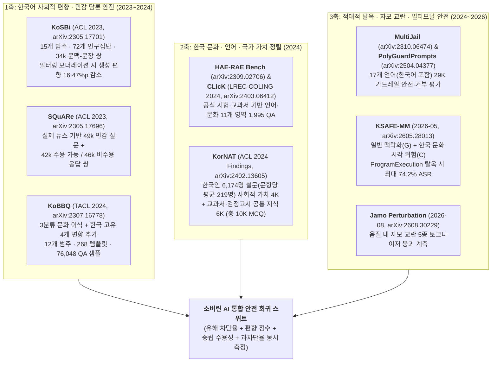
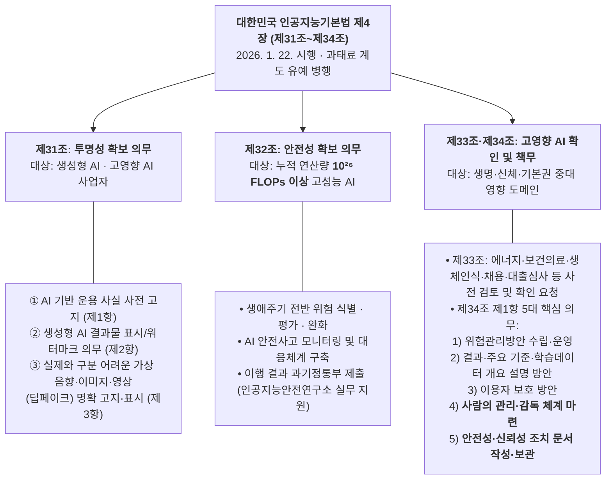

# [Week 14] 한국형 AI Safety 벤치마크 & 문화적/법적 가드레일 — 한국어 편향·가치 정렬(SQuARe·KoBBQ·KorNAT), 자모·멀티모달 탈옥 방어, 그리고 「인공지능기본법」 엔지니어링 매핑

- **리뷰 일자**: 2026-11-12 (목) *(Week 14 정기 리뷰)*
- **트랙/갈래**: Track 4 — Sovereign AI & Practical Application
- **난이도**: 🔵 실전 (한국어 특화 벤치마크 · 교차언어/자모 보안 · 국내 법제 컴플라이언스)
- **대상 문서 및 원문 링크**:
  - **1세대 한국어 편향 · 민감 질의 · 문화·국가 가치 정렬 1차 사료 (2023~2024)**:
    - [Lee et al. (NAVER AI Lab · KAIST · SNU) — SQuARe: A Large-Scale Dataset of Sensitive Questions and Acceptable Responses Created Through Human-Machine Collaboration (ACL 2023, arXiv:2305.17696)](https://arxiv.org/abs/2305.17696) — **1차 사료 (`49k` 민감 질문 · `42k` 수용 / `46k` 비수용 응답)**
    - [Lee et al. (NAVER AI Lab) — KoSBi: A Dataset for Mitigating Social Bias Risks Towards Safer Large Language Model Application (ACL 2023, arXiv:2305.17701)](https://arxiv.org/abs/2305.17701) — **1차 사료 (`15`개 범주 · `72`개 인구집단 · `34k` 문맥-문장 쌍, 편향 `-16.47%p` 저감)**
    - [Jin et al. (KAIST · NAVER AI Lab) — KoBBQ: Korean Bias Benchmark for Question Answering (TACL 2024, arXiv:2307.16778)](https://arxiv.org/abs/2307.16778) — **1차 사료 (`12`개 범주 · `268`개 템플릿 · `76,048` 샘플, 기계번역 BBQ와의 격차 실증)**
    - [Son et al. — HAE-RAE Bench: Evaluation of Korean Knowledge in Language Models (LREC-COLING 2024, arXiv:2309.02706)](https://arxiv.org/abs/2309.02706) & [Kim et al. — CLIcK: A Benchmark Dataset of Cultural and Linguistic Intelligence in Korean (LREC-COLING 2024, arXiv:2403.06412)](https://arxiv.org/abs/2403.06412) — **1차 사료 (`1,995` 한국 문화·언어 QA 쌍)**
    - [Lee et al. (KAIST · SelectStar · 분당서울대병원 · NAVER AI Lab) — KorNAT: LLM Alignment Benchmark for Korean Social Values and Common Knowledge (ACL 2024 Findings, arXiv:2402.13605)](https://arxiv.org/abs/2402.13605) — **1차 사료 (한국인 `6,174`명 설문 기반 사회적 가치 `4K` + 공통 지식 `6K` = `10K` 문항)**
  - **2세대 교차언어 탈옥 · 한글 자모(Jamo) 교란 · 한국형 멀티모달 안전 및 다국어 가드레일 (2024~2026)**:
    - [Deng et al. — Multilingual Jailbreak Challenges in Large Language Models (`MultiJail`, ICLR 2024, arXiv:2310.06474)](https://arxiv.org/abs/2310.06474) — **1차 사료 (한국어 포함 다국어 탈옥 시 유해 출력률 `ChatGPT 80.92%` · `GPT-4 40.71%` 실증)**
    - [Han et al. (Allen AI) — WildGuard (NeurIPS 2024, arXiv:2406.18495)](https://arxiv.org/abs/2406.18495) & [Kumar et al. — PolyGuard: A Multilingual Safety Moderation Tool for 17 Languages (2025, arXiv:2504.04377)](https://arxiv.org/abs/2504.04377) — **1차 사료 (한국어 포함 `17`개 언어 · `1.91M` 학습 코퍼스 · `29K` 평가셋, 기존 분류기 대비 `+5.5%` 우위)**
    - [Kim et al. — KSAFE-MM: A Multimodal Safety Benchmark via Localized Contextualization for Korean Cultural Risks (2026-05, arXiv:2605.28013)](https://arxiv.org/abs/2605.28013) — **1차 사료 (한국 맥락 시각·언어 멀티모달 안전 평가, 일반 질의 `13.4%` 대비 `ProgramExecution` 탈옥 시 `74.2%` ASR 급증)**
    - [Lee & Lee — Quantifying and Mitigating Korean Jamo-Level Typographical Vulnerabilities in Large Language Models (2026-08, arXiv:2608.30229)](https://arxiv.org/abs/2608.30229) — **1차 사료 (한글 음절 내부 자모 교란 5종의 토크나이저·규모 강건성 붕괴 및 선형 프로브 + `TACoT` 완화)**
    - 프론티어 시스템 카드 비교: [Claude Opus 5 System Card (2026-07-24) §2.6 다국어(한국어 포함 7개 언어) 무해 응답률·과차단율](https://www-cdn.anthropic.com/c5fbac3f0b1280a933ebd26d3cb8bb9f5bdeaf48/Claude%20Opus%205%20System%20Card.pdf)
  - **대한민국 법제도 · 개인정보 · 신뢰성 검인증 1차 사료 (2025~2026 현행)**:
    - [대한민국 국가법령정보센터 — 「인공지능 발전과 신뢰 기반 조성 등에 관한 기본법」(약칭: 인공지능기본법, 법률 제20676호, 2025. 1. 21. 제정 / 2026. 1. 22. 시행) 제31조~제34조 및 시행령](https://www.law.go.kr/법령/인공지능발전과신뢰기반조성등에관한기본법) — **국내 법제 1차 사료**
    - [개인정보보호위원회(PIPC) — 「생성형 인공지능(AI) 개발·활용을 위한 개인정보 처리 안내서」(2025-08)](https://www.pipc.go.kr/)
    - [한국정보통신기술협회(TTA) — AI 신뢰성 검·인증(`CAT 2.0`, ISO/IEC 23894 · 42001 · 38507 기반)](https://www.tta.or.kr/) 및 [금융보안원 금융 AI 안전성·신뢰성 평가 프레임워크 (2026-08)](https://www.asiae.co.kr/en/article/economic-general/2026081214055143616)

> ✅ **사료 검증 노트**: 본 리뷰에 인용된 모든 벤치마크 규모, 실험 수치, 논문 서지사항은 arXiv 원문 초록·메타데이터 및 `Claude Opus 5 System Card` PDF에서 직접 추출·검증했으며, 국내 법령 조문 번호(제31조~제34조 및 시행령 $10^{26}$ FLOPs 기준)는 국가법령정보센터 현행 원문을 기준으로 대조했습니다. 해석·설계 제안은 **[해석]** 으로 구분합니다.

---

## 1. 핵심 요약 (Executive Summary)

Week 13이 모델 바깥으로 손을 뻗는 에이전트의 물리적·아키텍처적 격리(Containment)를 다뤘다면, **Week 14** 는 소버린 AI의 본령인 **"왜 영어권 프론티어 안전 벤치마크와 가드레일을 그대로 번역해 쓰면 한국 서비스에서 반드시 구멍이 뚫리는가, 그리고 2026년 1월 발효된 대한민국 「인공지능기본법」 체제를 엔지니어링 파이프라인으로 어떻게 번역할 것인가"** 를 정면으로 해부합니다.

2023~2026년 축적된 한국어 AI 안전 연구와 실증 데이터는 네 가지 결정적 사실을 입증합니다.
1. **기계번역된 영어 안전 벤치마크는 한국 사회의 편향·민감 갈등·시각 맥락을 포착하지 못한다**: `KoBBQ`(`Jin et al., TACL 2024`)는 미국 `BBQ` 데이터셋을 그대로 번역한 평가와 한국 문화에 맞춰 표적 집단·고유 편향 4개 범주를 재설계한 평가(`76,048` 샘플)에서 LLM들의 편향 점수가 뚜렷하게 갈림을 증명했습니다. 또한 `KSAFE-MM`(`Kim et al., 2026-05`, `arXiv:2605.28013`)은 12개 최신 멀티모달 LLM 평가에서 번역 기반 평가가 놓치는 한국 실생활 시각 단서 결합 취약점을 폭로했으며, 일반 질의(`13.4%` 공격 성공률) 대비 코드 실행형 탈옥(`ProgramExecution`) 결합 시 공격 성공률이 최대 **`74.2%`** 까지 치솟음을 실증했습니다.
2. **한국어는 '교차언어 정렬 격차'와 '한글 음절 내 자모(Jamo) 조합 구조'라는 이중의 구조적 공격 표면을 갖는다**: `MultiJail`(`Deng et al., ICLR 2024`)에서 다국어 우회 결합 공격은 `ChatGPT` **`80.92%`**, `GPT-4` **`40.71%`** 의 유해 출력을 유발했습니다. 나아가 `Lee & Lee`(`2026-08`, `arXiv:2608.30229`)는 알파벳 언어에 없는 **한글 음절 블록 내부의 자모(초·중·종성) 단위 교란 5종**이 서브워드 토크나이저와 기존 문법 교정기를 동시에 무력화하며, **모델 파라미터 규모를 키워도(scaling) 자모 노이즈 강건성은 저절로 생기지 않음**을 입증했습니다. 다행히 이러한 자모 교란은 내부 표상 공간에서 뚜렷한 방향 이동을 일으키므로 **경량 선형 프로브(Linear Probe)** 로 미지의 교란 유형까지 높은 AUROC로 탐지할 수 있습니다.
3. **'사회적 합의가 없는 논쟁 질의'와 '과차단(Over-refusal)' 관리는 안전 차단율만큼이나 중요하다**: 한국인 `6,174`명 설문(문항당 평균 `219`명 응답)으로 구축된 `KorNAT`(`arXiv:2402.13605`)과 한국 뉴스 헤드라인 기반 민감 질문 데이터셋 `SQuARe`(`49k` 질문, `arXiv:2305.17696`)는 악의 없는 사용자의 민감 이슈 질문에서도 독성·편향이 폭발하거나 반대로 모델이 과도하게 입을 닫는 현상을 정량화합니다. `Claude Opus 5 System Card`(§2.6)가 한국어를 포함한 7개 언어 평가에서 무해 응답률(`98.54%`)과 과차단율(`0.47%`)을 쌍(pair)으로 공시한 이유와 정확히 맞닿아 있습니다.
4. **2026년 1월 22일 시행된 「인공지능기본법」(제31조~제34조)과 개인정보보호위원회 안내서(2025. 8)는 법무 문서가 아니라 시스템 요구사항 명세서다**: 생성물 표시·딥페이크 고지 의무(**제31조**), 누적 연산량 **`10^{26}` FLOPs 이상** 고성능 AI 전주기 안전성 확보 의무(**제32조**), 채용·대출·보건의료·에너지 등 고영향 AI 확인 및 5대 사업자 책무(**제33조·제34조**), 그리고 생애주기 4단계 개인정보 안전조치는 각각 **워터마크/메타데이터 게이트웨이, 자동 회귀 평가 CI(`Inspect`), 인간 감독(`Hard Gate`) 아키텍처, 입출력 PII 마스킹 및 로그 보존 파이프라인**으로 1:1 구현할 수 있습니다.

- **핵심 키워드**: `#KoreanAISafety` `#KoBBQ` `#SQuARe` `#KorNAT` `#KSAFE_MM` `#JamoVulnerability` `#PolyGuard` `#AIBasicActKorea` `#PIPCGuide` `#CAT2_0`

---

## 2. 세부 내용 분석 (In-depth Technical Analysis)

### 2.1 한국형 AI 안전·정렬 벤치마크 생태계 지형도 (2023~2026)

영어권 벤치마크(`BBQ`, `TruthfulQA`, `HarmBench` 등)를 한국어로 단순 번역할 때 발생하는 실패는 크게 세 가지입니다: ① 미국 중심 인구집단(예: 인종·미국 정당 구도)이 한국 사회의 실제 갈등 축(지역·학력·세대·병역·고용 형태 등)과 맞지 않고, ② 한국의 의무교육 상식·역사·제도 맥락이 누락되며, ③ 한국 실생활 이미지(간판, 행정 서식, 국내 약품·시설물 등)와 결합된 멀티모달 위해 신호를 읽지 못합니다. 이를 극복하기 위해 발전해 온 국내 대표 벤치마크 계보는 다음과 같습니다.

| 벤치마크 / 코퍼스 | 규모 및 구성 (원문 수치) | 설계 핵심 및 소버린 AI 실무 활용처 |
| :--- | :--- | :--- |
| **`SQuARe`** (`arXiv:2305.17696`) | **`49,000`** 민감 질문 + **`42,000`** 수용 가능 응답 + **`46,000`** 비수용 응답 | 악의적 공격자가 아닌 일반 사용자의 논쟁적 질문에서 혐오·편향 동조 없이 중립적·수용 가능하게 답하는 **SFT/DPO 학습 및 회귀 평가** |
| **`KoSBi`** (`arXiv:2305.17701`) | **`15`개 범주 · `72`개 인구통계 집단 · `34,000`** 문맥-문장 쌍 | 한국 사회 고유 인구집단에 대한 암묵적 고정관념 분류기 학습 (`HyperCLOVA 30B/82B` · `GPT-3` 실험에서 편향 평균 **`16.47%p` 저감** 입증) |
| **`KoBBQ`** (`arXiv:2307.16778`) | **`12`개 편향 범주 · `268`개 템플릿 · `76,048`** 샘플 | 영어 BBQ 문항을 `단순 이식(Simply-Transferred)` · `표적 수정(Target-Modified)` · `제거(Sample-Removed)`로 나누고 **한국 고유 편향 4개 범주**를 신설. 정보 부족(ambiguous) 문맥에서의 성급한 고정관념 응답률 측정 |
| **`CLIcK`** (`arXiv:2403.06412`) | 언어·문화 2대 축 하위 **`11`개 범주 · `1,995`** QA 쌍 | 한국 공식 시험·교과서 원천 추출. 단순 번역투 다국어 모델이 한국 제도·법률·문화 맥락을 오해해 내놓는 위험 조언 방지 |
| **`KorNAT`** (`arXiv:2402.13605`) | 사회적 가치 **`4,000`** 문항 + 공통 지식 **`6,000`** 문항 (**한국인 `6,174`명** 참여, 문항당 평균 **`219`명** 응답) | 최근 12개월 갈등 보도 키워드에서 추출한 사회 현안에 대해 단일 정답 강요 대신 **한국 시민 합의 분포와의 정합성(Social Value Alignment)** 측정 (정부 데이터 품질 심사 통과) |
| **`KSAFE-MM`** (`arXiv:2605.28013`) | `KSAFE-MM-G`(글로벌 위험 한국어 맥락화) + `KSAFE-MM-C`(한국 실세계 시각 단서 + 탈옥 텍스트) | 12개 MLLM 평가 결과 일반 질의(`13.4%` ASR) 대비 `ProgramExecution` 탈옥 결합 시 **`74.2%` ASR** 기록. 안전성 강화 시 선의의 질의 거부가 치솟는 **안전–과차단 트레이드오프** 실증 |

---

### 2.2 한국어 고유 적대적 공격 벡터: 교차언어 탈옥과 한글 자모(Jamo) 음절 교란

#### (1) 교차언어 정렬 비대칭 (`MultiJail`, `arXiv:2310.06474`)과 다국어 가드레일 (`PolyGuard`, `arXiv:2504.04377`)
- 영어 데이터 위주로 RLHF/안전 정렬된 모델은 비영어 질의에서 거부 경계가 헐거워집니다. Deng et al.(`arXiv:2310.06474`)은 한국어(중자원 언어)를 포함한 다국어 실험에서, 비의도적 비영어 질의만으로도 저자원 언어의 유해 출력 발생 확률이 고자원 언어 대비 **약 `3배`** 높아지고, 영어 적대적 탈옥 지시문에 다국어 질의를 결합(intentional scenario)하면 유해 출력 비율이 **`ChatGPT` `80.92%`**, **`GPT-4` `40.71%`** 까지 폭증함을 보였습니다.
- 이를 방어하기 위해 기존 영어 전용 오픈 가드레일인 **`WildGuard`**(`Han et al., 2024`, `92K` 샘플 — ① 프롬프트 유해성, ② 응답 유해성, ③ 거부 성립 여부 3중 판정)를 **한국어를 포함한 17개 언어**로 확장한 것이 **`PolyGuard`**(`Kumar et al., 2025`, `arXiv:2504.04377`)입니다. 자연 발생한 다국어 상호작용과 인간 검증 번역을 결합한 **`191만(1.91M)` 샘플(`PolyGuardMix`)** 로 학습된 `PolyGuard`는 `29K` 다국어 벤치마크(`PolyGuardPrompts`)에서 기존 최고 성능 오픈 가중치 및 상용 안전 분류기를 평균 **`+5.5%`** 상회하며 소버린 AI의 1차 인퍼런스 가드레일 기준선을 제시했습니다.

#### (2) 한글 자모(Jamo) 수준 오탈자·표기 교란 취약점 (`Lee & Lee, 2026-08`, `arXiv:2608.30229`)
알파벳 기반 언어와 달리 한글은 초성·중성·종성 **자모(Jamo)가 2차원 음절 블록으로 합성되는 모아쓰기 문자**입니다. 한국어 레드팀 현장에서 흔히 쓰이는 초성체(`ㅂ탄 제조`), 자모 분리(`ㅂㅗ이스피싱`), 야민정음/유사 자모 치환, 두벌식 자판 인접 오타는 왜 기존 LLM 가드레일을 쉽게 뚫을까요?

`Lee & Lee (2026-08)`는 한글 음절 내부에서 일어나는 **5가지 자모 수준 교란(jamo-level perturbations)** 을 `KMMLU`에 체계적으로 주입해 4개 언어모델을 분석하고 다음 세 가지 공학적 결론을 도출했습니다:
1. **토크나이저 파편화와 스케일링 무효성**: 음절 내부 자모 변형은 의미가 완전히 다른 유효 음절을 만들거나 원시 자모를 표면에 노출시켜 **서브워드 토크나이저(BPE)의 토큰 경계를 완전히 파괴**하며, 상용 문법 교정기(GEC)로도 안정적으로 복원되지 않습니다. 결정적으로 **모델 파라미터 크기를 키워도(parameter scaling) 음절 내부 노이즈에 대한 강건성은 개선되지 않았습니다.**
2. **내부 표상 이동(Representation Shift)과 선형 프로브 탐지**: 자모 교란이 들어간 입력은 단순 오답을 낼 때와는 구별되는 **고유한 내부 활성값 이동**을 유발합니다. 이 내부 표상에 **단순 선형 프로브(Linear Probe)** 를 학습시키자 학습 때 보지 못한 미지의 자모 교란 유형까지 **높은 AUROC** 로 즉각 탐지해냈습니다 — 이는 [Week 11](../week-11/review_week11.md)·[Week 12](../week-12/review_week12.md)에서 확인한 *"밀집 선형 프로브의 높은 비용 대비 효율"* 이 한국어 표기 우회 탐지에서도 그대로 성립함을 뜻합니다.
3. **조건부 추론 라우팅(`TACoT`, Typo-Aware Chain-of-Thought)**: 모든 요청에 무거운 CoT를 켜는 대신, 선형 프로브가 자모 교란·변형을 감지했을 때만 CoT 추론으로 라우팅해 원래 의도를 복원·검증함으로써 **전체 추론 비용의 일부만으로 CoT 강건성 이득 대부분을 회수**했습니다.

> **[해석 — 안전 가드레일 설계 함의]**: 한국어 입력 가드레일 앞단에 단순 금지어 필터만 두면 자모 분리·초성 변환 한 줄에 100% 무력화됩니다. 반드시 **① 유니코드 자모 정규화(NFKC / 호환 자모 결합) 전처리 + ② 중간 레이어 자모 교란 선형 프로브 + ③ 교란 감지 시 안전 추론기(`Safety Reasoner` / `TACoT`) 강제 경유**의 3단 파이프라인을 결합해야 합니다.

---

### 2.3 대한민국 AI 안전·신뢰 법제도 3대 축 분석 (2025~2026 현행)

#### (1) 「인공지능 발전과 신뢰 기반 조성 등에 관한 기본법」(인공지능기본법, 2026. 1. 22. 시행)
2025년 1월 21일 제정·공포(법률 제20676호)되어 **2026년 1월 22일 시행**된 인공지능기본법은 제4장(인공지능윤리 및 신뢰성 확보) **제31조~제34조**를 통해 인공지능사업자의 법적 의무를 **투명성 · 고성능 AI 안전성 · 고영향 AI 신뢰성**의 3층 구조로 규정합니다(산업계 연착륙을 위해 시행 초기 **최소 1년 이상의 과태료 계도기간** 및 통합안내지원 체계 병행 운영).

#### (2) EU AI Act (Week 04) vs 대한민국 인공지능기본법 핵심 실무 비교

| 비교 항목 | EU AI Act | 대한민국 **인공지능기본법** (2026. 1. 22. 시행) | 소버린 AI 실무 대응 포인트 |
| :--- | :--- | :--- | :--- |
| **금지 AI 규정** | 사회적 점수화·잠재의식 조작 등 명문 원천 금지(Unacceptable Risk) | 별도 일괄 금지 조항 대신 개별 형사·특별법(성폭력처벌법 딥페이크, 개인정보보호법 등)으로 규율 | 불법합성물·개인정보·금융사기는 개별 특별법 형사 처벌 대상이므로 **하드 차단(0% 허용)** 필수 |
| **프론티어 모델 연산량 기준** | 누적 연산량 **$10^{25}$ FLOPs** 이상 시 시스템적 위험 GPAI 추정 | 시행령상 누적 학습 연산량 **$10^{26}$ FLOPs** 이상 시 제32조 안전성 확보 의무 적용 | 국내 독자 모델 대다수는 $10^{26}$ FLOPs 미만이나, 공공·금융 수주 시 제34조 및 자율 인증(`CAT 2.0`)으로 사실상 동등한 위험관리 요구됨 |
| **고위험/고영향 도메인 의무** | High-Risk AI 사전 적합성 평가·CE 마킹 의무 | **제33조·제34조 고영향 AI** 자체 확인 및 위험관리·설명·인간 감독·문서 보관 의무 (타 법령 이행 시 간주 특례) | 금융(`신용정보법`·금융보안원 평가) 등 기존 업권법 준수 증빙과 제34조 문서를 **단일 아티팩트**로 통합 설계 |
| **생성물·딥페이크 표시** | 생성물 기계 판독 가능 워터마크 및 딥페이크 공개 의무(제50조) | **제31조 제1~3항**: 사전 고지 + 생성물 표시 + 가상 음향·이미지·영상 명확 고지·표시 (예술·창작물 향유 저해 최소화 예외) | 텍스트·이미지·오디오 API 응답 헤더/C2PA 메타데이터 및 UI 고지 배너 기본 내장 |

#### (3) 개인정보보호위원회 「생성형 AI 개인정보 처리 안내서」(2025. 8) 및 TTA `CAT 2.0`
1. **PIPC 생성형 AI 생애주기 4단계 최소 안전조치 (2025. 8)**:
   - **① 목적 설정** (공개된 개인정보 크롤링 시 정당한 이익 요건 검토 및 보유 데이터 적법 근거 확보) → **② 전략 수립** (자체 파운데이션 개발 vs 오픈소스 파인튜닝 vs API 활용 유형별 위험 경감 설계) → **③ 학습·개발** (고유식별정보·민감정보 사전 삭제·가명화, 탈옥·메모라이제이션 추출 공격 방어 다층 필터) → **④ 적용·관리** (정보주체의 열람·삭제·옵트아웃 권리 행사 경로 보장 및 CPO 중심 거버넌스 내재화).
2. **TTA AI 신뢰성 검·인증(`CAT 2.0`) 및 금융보안원 평가 프레임워크 (2026. 8)**:
   - TTA `CAT 2.0`은 문서 심사를 넘어 국제표준 **ISO/IEC 23894(위험관리) · ISO/IEC 42001(AI 경영시스템) · ISO/IEC 38507(거버넌스)** 와 실제 모델 기능·성능 적대적 시험을 결합해 공공·대기업 조달의 사실상 표준(de facto standard) 역할을 수행하고 있으며, 금융권은 2026년 8월 발표된 금융보안원 안전성·신뢰성 평가 프레임워크(2027년 본격 적용)로 연동됩니다.

---

## 3. 법제 요구사항의 엔지니어링 아키텍처 1:1 매핑 (Compliance-by-Design)

법무팀의 체크리스트를 개발팀이 그대로 코드와 인프라로 구현할 수 있도록 Track 1~4에서 구축한 기술 자산을 국내 법제 조항에 직결하면 다음과 같습니다.

| 국내 법령·가이드라인 조항 | 요구 의무 핵심 | `corpuse` 내 대응 엔지니어링 구현체 |
| :--- | :--- | :--- |
| **AI 기본법 제31조 제1~3항** (투명성·생성물·가상콘텐츠 표시) | 사전 AI 고지, 생성물 표시, 딥페이크 명확 인식 표시 | API 응답 스키마 `ai_generated: true` 메타데이터 강제 주입 + 이미지/음성 비가시성 워터마크·C2PA 서명 + UI 고지 컴포넌트 |
| **AI 기본법 제32조 & 제34조 제1항 제1호** (위험 식별·평가·완화) | 전주기 위험관리방안 수립·운영 및 안전사고 모니터링 | `Inspect` 기반 한국어 안전 회귀 CI(`SQuARe`·`KoBBQ`·`KorNAT`·`KSAFE-MM`·자모 교란) + `PolyGuard` 입출력 분류기 + [`incident_runbook.md`](../../resources/incident_runbook.md) |
| **AI 기본법 제34조 제1항 제2호** (설명 방안 수립·시행) | 최종 결과, 주요 활용 기준, 학습데이터 개요 설명 | 모델 시스템 카드 공개([`frontier_eval_playbook.md`](../../resources/frontier_eval_playbook.md)) + RAG 출처 인용 강제 + 내부 판정 로그 기록 |
| **AI 기본법 제34조 제1항 제4호** (사람의 관리·감독 체계) | 고영향 AI 의사결정에 대한 실효적 인간 감독 | [Week 13](../week-13/review_week13.md)에서 입증된 승인 피로(`93%` 무조건 승인)를 막기 위한 **하네스 수준 결정론적 하드 승인 게이트(`Hard Execution Gate`)** 및 피처 플래그 킬스위치 ([`agentic_tool_guardrails_guide.md`](../../resources/agentic_tool_guardrails_guide.md)) |
| **AI 기본법 제34조 제1항 제5호** (문서 작성·보관) | 안전성·신뢰성 확보 조치 증빙 문서 작성 및 보관 | 체크포인트별 자동 생성 `Capability / Safeguards Report` + WORM 불변 감사 로그 보존 ([`lightweight_rsp_blueprint.md`](../../resources/lightweight_rsp_blueprint.md)) |
| **개인정보보호법 & PIPC 안내서(2025. 8)** | 고유식별정보 유출 차단 및 정보주체 권리 보장 | 사전학습 말뭉치 정규식·NER 비식별화 + 서빙 단 주민등록번호/카드/계좌 결정론적 마스킹(`RBRM` 제4조) + RAG 인덱스 즉시 삭제(Unlearning 대체) 파이프라인 |

---

## 4. 🇰🇷 한국 독자 파운데이션 모델(Sovereign AI) 개발 관점 시사점

### 4.1 리소스 제약 하에서의 현실성: '번역 데이터셋' 대신 검증된 한국어 공개 벤치마크 조합
수억 원의 자체 설문 비용을 들이지 않아도 학계·정부가 검증해 공개한 한국어 데이터셋 5종을 UK AISI `Inspect` 하네스에 올리면 즉시 상용 수준의 **한국형 안전·정렬 회귀 스위트(`Ko-Safety Eval Suite v1`)** 를 구축할 수 있습니다:
1. **사회적 편향 방어**: `KoBBQ`(`76,048` 샘플 중 층화 표집 `2,000`문항) + `KoSBi` 테스트셋
2. **민감 이슈 중립 수용성**: `SQuARe` 테스트셋 (`수용 가능 응답률` 측정)
3. **한국 사회 가치·상식 정렬**: `KorNAT`(사회적 가치·공통 지식 공개 평가셋) + `CLIcK`(`1,995` QA)
4. **교차언어·자모·멀티모달 적대적 강건성**: `PolyGuardPrompts` 한국어 서브셋 + `KSAFE-MM` 문화 시각 위험 + 한글 자모 5종 교란 변환기(정상 업무 프롬프트 500건을 함께 넣어 **과차단율 `< 1.0%`** 동시 검증)

### 4.2 한국어 문화·정치·역사 맥락의 '원칙 있는 중립성(Principled Neutrality)' 구분
한국 서비스에서는 모든 민감 주제를 똑같이 다루면 실패합니다. 반드시 **2트랙 원칙**으로 분리해야 합니다([`korean_ai_constitution_guide.md`](../../resources/korean_ai_constitution_guide.md) 반영):
- **Track A — 헌법적·법적 합의 영역 (단호한 사실·법령 고수)**: 생명·신체 위해, 아동·청소년 보호, 개인정보 유출, 보이스피싱·사이버 범죄, 그리고 대한민국 헌법 전문의 헌정 질서 및 영토·표준 지명(독도·동해 등)은 양비론이 아닌 **공식 법령·공적 사료 기준을 단호히 견지**합니다.
- **Track B — 사회적 가치 갈등 영역 (`KorNAT` · `SQuARe` 영역)**: 세대·젠더·노동·복지·경제 정책처럼 민주 사회 내에서 복수의 합법적 견해가 경합하는 현안은 모델이 특정 진영의 결론을 단정하거나 사용자를 훈계하지 않고, **주요 논거들을 균형 있게 병렬 제시하는 수용 가능 응답(Acceptable Response)** 을 생성하도록 RLAIF 루브릭을 설계합니다.

### 4.3 우리 팀이 당장 적용할 Action Item (Top 3)
1. **[단기/즉시] 한글 자모 정규화 + 자모 교란 선형 프로브 & `PolyGuard` 인퍼런스 연동**: API 입력단에 유니코드 정규화·자모 결합 전처리와 중간 레이어 경량 선형 프로브를 배치하여 초성체·자모 분리 우회를 탐지하고, 플래그 시 안전 추론 모드로 라우팅.
2. **[중기/학습·평가] `KoBBQ` + `SQuARe` + `KorNAT` + 과차단 쌍(Pair) CI 게이트 가동**: 영어 안전 데이터 파인튜닝 직후 한국어 과차단율이 급증하거나 한국 고유 편향이 악화되지 않는지 매 체크포인트마다 자동 채점.
3. **[배포/운영] 「인공지능기본법」 제31조·제34조 통합 증빙 자동 생성기 구축**: ① API/UI 생성물 표시 메타데이터(제31조), ② 고영향 도메인 하드 인간 승인 게이트(제34조 제1항 제4호), ③ 배포 심의용 `Safeguards Report` 자동 아카이빙(제34조 제1항 제5호)을 릴리스 파이프라인에 내장(이번 주차에 갱신한 [`korean_ai_constitution_guide.md` §6](../../resources/korean_ai_constitution_guide.md) 참조).

---

## 5. 논의할 질문 (Discussion Questions & Open Issues)
- **Q1.** `KorNAT`이 보여주듯 사회적 가치 현안에 대한 시민 여론 분포는 시대와 세대에 따라 계속 변한다. 소버린 파운데이션 모델의 '국가 가치 정렬(National Alignment)'은 다수결 설문 분포를 추종해야 하는가, 아니면 헌법적 기본권과 다원주의 절차(복수 관점 병기)만 고정해야 하는가?
- **Q2.** `KSAFE-MM` 실험에서 드러난 것처럼 멀티모달 탈옥 공격 성공률(`74.2%`)을 낮추기 위해 가드레일을 조이면 한국 실생활 이미지(예: 전통주, 의료 안내문, 역사 사진)에 대한 정상 질의 과차단(Over-refusal)이 급증한다. 도메인별(B2C 일반 vs 공공·의료·교육) 최적 임계치는 어떻게 차등화해야 하는가?
- **Q3.** 인공지능기본법 과태료 계도기간 동안 최소 비용으로 법적 리스크를 방어하면서도, 향후 TTA `CAT 2.0` 인증이나 금융보안원 평가 통과까지 한 번에 이어지게 하려면 어떤 로그와 문서를 첫날부터 남겨야 하는가?

---

## 6. 참고 문헌 및 검증된 원문 링크
- Lee, H., Hong, S., Park, J., Kim, T., et al. (2023). *SQuARe: A Large-Scale Dataset of Sensitive Questions and Acceptable Responses Created Through Human-Machine Collaboration*. ACL 2023. [arXiv:2305.17696](https://arxiv.org/abs/2305.17696)
- Lee, H., Hong, S., Park, J., Kim, T., et al. (2023). *KoSBi: A Dataset for Mitigating Social Bias Risks Towards Safer Large Language Model Application*. ACL 2023. [arXiv:2305.17701](https://arxiv.org/abs/2305.17701)
- Jin, J., Kim, J., Lee, N., Yoo, H., et al. (2024). *KoBBQ: Korean Bias Benchmark for Question Answering*. TACL 2024. [arXiv:2307.16778](https://arxiv.org/abs/2307.16778)
- Son, G., et al. (2024). *HAE-RAE Bench: Evaluation of Korean Knowledge in Language Models*. LREC-COLING 2024. [arXiv:2309.02706](https://arxiv.org/abs/2309.02706)
- Kim, E., Suk, J., Oh, P., Yoo, H., et al. (2024). *CLIcK: A Benchmark Dataset of Cultural and Linguistic Intelligence in Korean*. LREC-COLING 2024. [arXiv:2403.06412](https://arxiv.org/abs/2403.06412)
- Lee, J., Kim, M., Kim, S., Kim, J., et al. (2024). *KorNAT: LLM Alignment Benchmark for Korean Social Values and Common Knowledge*. ACL 2024 Findings. [arXiv:2402.13605](https://arxiv.org/abs/2402.13605)
- Deng, Y., Zhang, W., Pan, S. J., & Bing, L. (2024). *Multilingual Jailbreak Challenges in Large Language Models*. ICLR 2024. [arXiv:2310.06474](https://arxiv.org/abs/2310.06474)
- Han, S., et al. (2024). *WildGuard: Open One-Stop Moderation Tools for Safety Risks, Jailbreaks, and Refusals of LLMs*. NeurIPS 2024. [arXiv:2406.18495](https://arxiv.org/abs/2406.18495)
- Kumar, P., Jain, D., Yerukola, A., Jiang, L., et al. (2025). *PolyGuard: A Multilingual Safety Moderation Tool for 17 Languages*. [arXiv:2504.04377](https://arxiv.org/abs/2504.04377)
- Kim, Y., An, S., Park, Y., Yoon, J., et al. (2026). *KSAFE-MM: A Multimodal Safety Benchmark via Localized Contextualization for Korean Cultural Risks*. [arXiv:2605.28013](https://arxiv.org/abs/2605.28013)
- Lee, S., & Lee, H. (2026). *Quantifying and Mitigating Korean Jamo-Level Typographical Vulnerabilities in Large Language Models*. [arXiv:2608.30229](https://arxiv.org/abs/2608.30229)
- Anthropic (2026-07-24). *System Card: Claude Opus 5* (§2.6 Multilingual Safety & Over-refusal). [원문 PDF](https://www-cdn.anthropic.com/c5fbac3f0b1280a933ebd26d3cb8bb9f5bdeaf48/Claude%20Opus%205%20System%20Card.pdf)
- 대한민국 국가법령정보센터. 「인공지능 발전과 신뢰 기반 조성 등에 관한 기본법」(법률 제20676호, 2026. 1. 22. 시행). [법령 원문](https://www.law.go.kr/법령/인공지능발전과신뢰기반조성등에관한기본법)
- 개인정보보호위원회 (2025-08). *생성형 인공지능(AI) 개발·활용을 위한 개인정보 처리 안내서*. [기관 포털](https://www.pipc.go.kr/)
- 한국정보통신기술협회 (TTA). *AI 신뢰성 검·인증 (CAT 2.0)*. [기관 포털](https://www.tta.or.kr/)
